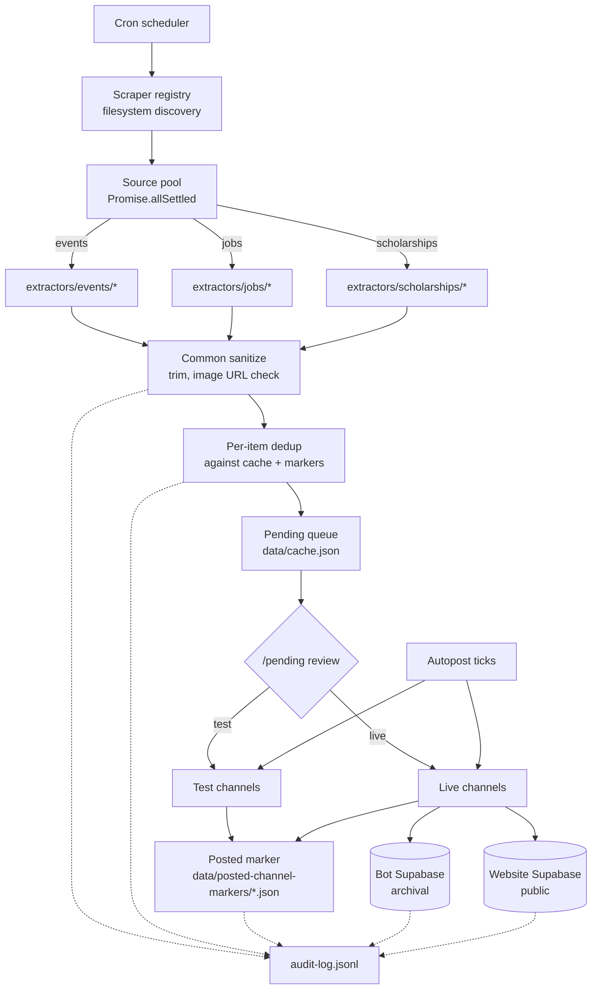

<div align="left">


# Pulchowk Events Aggregator

**Scrapes events, jobs, and scholarships from ten Nepali and international sources, deduplicates them, publishes to Discord, and syncs to a public website.**


| Sources | Categories | Delivery |
|---|---|---|
| **10** scraped<br/><sub>4 events · 4 jobs · 2 scholarships</sub> | **9** routed<br/><sub>sports, software, hardware, gaming, music, business, misc, jobs, scholarships</sub> | **3** targets<br/><sub>Discord test · Discord live · Supabase website</sub> |

[Architecture](#architecture) · [Quickstart](#quickstart) · [Setup wizard](#setup-wizard) · [Adding a source](#adding-a-source) · [Docs](#documentation) · [Issues](https://github.com/pulchowk-events/aggregator/issues)

</div>

---

## Contents

- [Overview](#overview)
- [Features](#features)
- [Sources supported](#sources-supported)
- [Architecture](#architecture)
- [Quickstart](#quickstart)
- [Setup wizard](#setup-wizard)
- [Adding a source](#adding-a-source)
- [Commands](#commands)
- [Configuration](#configuration)
- [Repository layout](#repository-layout)
- [Documentation](#documentation)
- [Limitations](#limitations)
- [License](#license)

---

## Overview

Events, jobs, and scholarship calls are posted across dozens of sites in Nepal — Khalti, KataJaam, NepVents, Kgarira, SathiJob, InternSathi, MeroJob, KumariJob, ScholarshipsAds, EACEA — each with its own page structure, its own taxonomy, its own idea of what "date" means. Keeping a Discord server and a website current against all of them by hand is not tractable.

This bot automates the whole loop. On a cron it scrapes every configured source in parallel through a headless browser, classifies each item into a category, deduplicates against a durable on-disk marker per (item, channel) pair, queues new items for human review, posts them on demand or on an autopost schedule, archives posted items to a Supabase project, mirrors a curated subset to the public website's Supabase, and audits every decision into an append-only local JSONL file.

## Features

- **A source is two files.** Adding a website to scrape is: create `src/scrapers/sources/<type>/<name>.js` (five-line wrapper), then `src/scrapers/extractors/<type>/<name>.js` and implement `extract()`. The registry discovers both at boot. Nothing in `src/core/`, `src/posting/`, or `src/discord/` needs to know the source exists.

- **Fail-closed duplicate prevention.** Every (item, channel) post is guarded by a marker file on disk. Markers carry a `postedAt` timestamp when the send succeeds. If the process crashes between confirming the marker and removing the item from the pending queue, the next startup reconciles it. If a marker's heartbeat is stale, the bot checks Discord itself before re-posting. Duplicates become near-impossible, at the cost of the rare skip — the correct trade-off for a community feed.

- **Test → live promotion gate.** Autopost can post only to test channels, letting a human eyeball each item before it goes live. Live posts are further constrained to a 6 AM–10 PM Nepal-time window because live posts ping roles, and 3 AM pings burn goodwill.

- **Drift detection in the scraper layer.** Every source reports `{ items, meta }` where `meta` carries `listingHits`, `detailPagesVisited`, `detailParseFailures`, and `looksBlocked`. When a run returns zero items, the classifier (`classifyOutcome` in `src/scrapers/diagnostics.js`) distinguishes between "genuinely empty" (fine), "the listing selector is stale" (drift at listing), "the detail selector is stale" (drift at detail), and "the site blocked us" (captcha / Cloudflare). Silent zeros become actionable signals.

- **Resilient selectors, not brittle ones.** Field extractions known to be unstable go through `pickOne` / `pickAll` (`src/scrapers/selectors.js`) with a fallback chain. When KataJaam changed its card class, one selector stopped matching and the bot returned zero events with no error. The current design logs a drift warning the moment a fallback fires, and continues working through minor class shuffles.

- **Audit-first.** `auditLog()` writes a line to `data/audit-log.jsonl` unconditionally. The Discord mirror is best-effort and never blocks the caller. A Discord outage can never mean zero record exists. Every dedup decision, every post outcome, every Discord API error is logged with the full payload — the local file is the forensic source of truth, not Discord.

- **Two-tier delivery.** Every item type has two delivery tracks: a bot archival Supabase (service-role, full records) and the public website's Supabase (a curated subset filtered by `hasValidImage`, data-quality warnings, and a user-collision check). The two are independent — either can fail without affecting the other, and either can be dry-run independently.

- **Guided wizards.** Two interactive CLIs: one to bootstrap a fresh deployment end-to-end (`scripts/setup/`) and one to scaffold a new scraper source against an LLM prompt (`scripts/wizard/`). Both can be walked with mock data (`--demo` / `--no-interactive`) so you can inspect the flow before running it.

## Sources supported

| Type | Source | Site | Notes |
|---|---|---|---|
| Events | Khalti | `events.khalti.com` | Single-page DOM harvest, no per-event navigation. Fastest source. |
| Events | KataJaam | `katajaam.com` | Nine category pages × per-event detail. Blur-up placeholder images need an `aria-hidden` filter. |
| Events | NepVents | `nepvents.com` | Three category pages. JSON-LD-first extraction with HTML fallback. Registration URL is discovered by clicking through the site's own button. |
| Events | Kgarira | `kgarira.com` | Three paginated listing pages × per-event detail. JSON-LD-first detail extraction. Pagination currently returns the same 3 items on each page — deduped downstream, just wasteful. |
| Jobs | SathiJob | `sathijob.com` | Virtualized listing, needs scroll-loop harvesting. Structured stat grid on detail pages. |
| Jobs | InternSathi | `internsathi.com` | Same structural shape as SathiJob. Slug encodes level/employment-type/mode — used as fallback. |
| Jobs | MeroJob | `merojob.com` | Normal server-rendered listing with real pagination. Deadlines are relative ("15 days from now") and are converted to absolute at scrape time. |
| Jobs | KumariJob | `kumarijob.com` | Normal listing with real pagination. Detail pages can apply offsite (LinkedIn, employer ATS). |
| Scholarships | ScholarshipsAds | `scholarshipsads.com` | Listing cards carry everything except deadline — one extra detail-page visit per item to read the real date. Cloudflare-challenged past page 1 of each category; extractor deliberately stops after page 1. |
| Scholarships | Erasmus Mundus | `eacea.ec.europa.eu` | Two-hop scrape. Deadlines are intentionally `unknown` (project duration ≠ application deadline). |

Full per-source deep dive (structural quirks, drift history, extraction strategy): [`docs/scrapers.md`](docs/scrapers.md#reference-the-10-current-sources).

## Architecture



Three properties the diagram is designed to make obvious: **one entry path into the cache** (only `processScrapedEvents` pushes items), **one entry path out** (only `postEventToCategory` sends Discord messages), and **one audit surface** (every decision writes through `auditLog`). Every module boundary in the repo exists to preserve those three properties.

For the full mental model — the ten-stage lifecycle of an item, the startup sequence, why `src/core/` is pure functions while `src/posting/` owns cache mutations, and the four load-bearing chokepoints — see [`docs/architecture.md`](docs/architecture.md).

## Quickstart

```bash
git clone https://github.com/pulchowk-events/aggregator.git
cd aggregator
npm install
cp .env.example .env
# fill in: DISCORD_TOKEN, HOME_GUILD_ID, LOGS_CHANNEL_ID, AUDIT_LOG_CHANNEL_ID,
#          category channel IDs, Supabase credentials
npm start
```

Node 18+ required. Puppeteer downloads Chromium (~150 MB) on install; set `BROWSER_EXECUTABLE_PATH` and `BROWSER_USER_DATA_DIR` in `.env` to use an existing browser instead (Windows deployments — see [Configuration](#configuration) for the WSL2 caveat).

To fill `.env` interactively instead of by hand, use the [setup wizard](#setup-wizard). To keep the process running in production (systemd / Task Scheduler / pm2), see [`docs/operations.md#keeping-the-process-alive`](docs/operations.md#keeping-the-process-alive).

Verify any single source in isolation before trusting a full scrape:

```bash
node scripts/verify-source.js scholarshipsads
node scripts/verify-source.js katajaam
```

This runs the extractor directly against the live site — no bot, no Discord, no cron — and prints item count, verdict, and a sample.

## Setup wizard

For a fresh deployment from zero, the setup wizard walks the entire flow interactively: Discord token → guild selection → category channel pick/create → logs/audit/alerts channels → ping roles → Supabase (both projects) → dashboard key → browser profile → `.env` write (with backup + diff preview) → optional boot test.

```bash
# Walk the entire flow with mock data (never touches .env, Discord, or Supabase)
node scripts/setup/index.js --demo

# Real setup
node scripts/setup/index.js
```

Every step asks before doing anything. Every side effect is opt-in. `.env` is never written without showing a diff and confirming. The demo mode writes to `data/demo-setup.env` (gitignored) so you can inspect the output without committing anything.

Full walkthrough of every step, what it writes, and how to undo: [`docs/operations.md#setup-wizard`](docs/operations.md#setup-wizard).

## Adding a source

Adding a new source is a two-file operation. No change to `src/core/`, `src/posting/`, or `src/discord/` is needed.

**1. The wrapper** at `src/scrapers/sources/<type>/<name>.js`:

```js
const { runSource } = require('../_orchestrate');

module.exports = {
    name: 'mynewsite',
    type: 'events',
    scrape: (ctx) => runSource('mynewsite', 'events', ctx)
};
```

**2. The extractor** at `src/scrapers/extractors/<type>/<name>.js`:

```js
module.exports = {
    async extract(page, { progress, meta }) {
        // All browser work here. Return { items, meta }.
        // The orchestrator handles: browser lifecycle, retry, common
        // sanitization, description trim, image URL validation, and
        // diagnostic classification. Do NOT duplicate that here.
        return { items: [...], meta };
    }
};
```

Commit both. Verify:

```bash
node scripts/verify-source.js mynewsite
```

When it returns `verdict: ok` with `items > 0`, the source is live. The registry discovers it on the next scrape run.

To scaffold a new source against an LLM prompt instead of writing the extractor by hand:

```bash
node scripts/wizard/index.js <url> <name> <type>
```

This dumps the site's DOM structure, classifies its shape (`jsonld-first` / `listing-to-detail` / `single-page-cards`), writes a ready-to-paste prompt for DeepSeek / ChatGPT / Claude, and walks you through pasting the LLM's code back in — with an automatic verify-source step at the end.

Full walkthrough (both manual and wizard paths, plus the drift-fixing playbook): [`docs/scrapers.md#adding-a-source-manual`](docs/scrapers.md#adding-a-source-manual) and [`docs/scrapers.md#adding-a-source-guided`](docs/scrapers.md#adding-a-source-guided).

## Commands

All commands are guild-scoped to `HOME_GUILD_ID` and require Discord's `ADMINISTRATOR` permission. There is deliberately no global registration — adding the bot to a foreign guild grants no access.

### Scraping and queue

| Command | Purpose |
|---|---|
| `/scrape [site]` | Manually trigger a scrape (all sources, or one) |
| `/pending [type]` | List pending items with per-item action buttons |
| `/preview <query>` | Render how a pending item will look when posted |
| `/restore <query>` | Bring a skipped item back to pending |
| `/cleanup <type> [source]` | Bulk-remove cached items by type and/or source |

### Posting control

| Command | Purpose |
|---|---|
| `/autopost start-test` / `start-live` | Start autopost for events, jobs, scholarships, or any combination |
| `/autopost stop` | Stop autopost per track/mode |
| `/autopost set-interval` | Change posting interval (0 = back-to-back) |
| `/autopost status` | Show active tracks and intervals |
| `/undo [query]` | Delete a live post and restore the item to pending |
| `/edit-live <query>` | Edit a live message's fields in place |

### Channel and category control

| Command | Purpose |
|---|---|
| `/category pause` / `resume` | Temporarily block a category from going live |
| `/blacklist add/remove/list` | Auto-skip scraped items by keyword or organizer |
| `/ping on/off/add/remove/category` | Control role pings on live posts |

### Sync and delivery

| Command | Purpose |
|---|---|
| `/supabase sync-now` | Upload unsynced posted items to the bot archival Supabase |
| `/supabase republish-all` | Force re-upload the entire posted-events cache |
| `/supabase autosync-start` / `stop` | Interval-based auto-sync |
| `/website-sync now` | Immediate public-site sync (events + jobs) |
| `/website-sync health` | Diff the bot's eligible set against the website |
| `/website-sync prune` | Force-delete orphans (bypasses threshold guard) |

### Diagnostics and maintenance

| Command | Purpose |
|---|---|
| `/status` | Pending/posted/skipped counts, autopost tracks, next scrape time |
| `/health` | Permission check across every configured channel |
| `/stats [days]` | Posting volume from the marker files |
| `/uptime` | Process uptime, memory, version |
| `/find <query>` | Search pending/posted/skipped/archived items by title |
| `/backup` | Download the current `cache.json` |
| `/clear-skipped` | Empty the in-memory skipped list |
| `/dedupe [channel] [limit]` | Scan live channels for duplicate messages and remove extras |
| `/publish-previous` | Retroactively dedupe + crosspost past live posts |
| `/autopublish on/off/status` | Auto-crosspost new posts after dedupe clears them |
| `/settings set-logs` / `set-schedule` / `set-lead-days` / `set-needs-attention-expiry-days` / `toggle-missed-scrape-catchup` | Persistent configuration overrides |
| `/shutdown` | Stop autopost and exit the process (for supervisor-managed restarts) |

## Configuration

Two independent config layers, both loaded at boot.

**Secrets and deployment identifiers — `.env`** (see [`.env.example`](.env.example)). Read via `src/config/env.js`, validated at startup. Every missing value produces a named warning rather than a silent `undefined`. Key vars:

| Var | Purpose |
|---|---|
| `DISCORD_TOKEN` | Bot login token |
| `HOME_GUILD_ID` | The one guild the bot answers in — every command checks this |
| `LOGS_CHANNEL_ID` | Curated human-facing feed — scrape progress, post results |
| `AUDIT_LOG_CHANNEL_ID` | Exhaustive audit trail mirror |
| `ALERTS_CHANNEL_ID` / `ALERTS_PING_ROLE_ID` | Time-sensitive source-failure alerts (optional) |
| `*_CHANNEL_ID` (one pair per category) | Main + test channel for each of the 9 categories |
| `JOBS_PING_ROLE_ID` / `SCHOLARSHIPS_PING_ROLE_ID` | Optional ping roles for those categories |
| `SUPABASE_URL` + `SUPABASE_SERVICE_ROLE_KEY` | Bot archival Supabase |
| `WEBSITE_SUPABASE_URL` + `WEBSITE_SUPABASE_SERVICE_ROLE_KEY` | Public website Supabase |
| `WEBSITE_SYNC_DRY_RUN` | `true` to preview website changes without writing |
| `BROWSER_EXECUTABLE_PATH` + `BROWSER_USER_DATA_DIR` | Windows-only: real browser + warm profile for Cloudflare/login-required sites |

**Server-specific non-secrets — `src/config/`.** Emoji IDs and ping role IDs live here so a forker can swap servers by editing three files, not re-running `.env` setup:

- `emojis.js` — all custom emoji references. Replace with your server's emoji IDs (right-click → Copy ID with Developer Mode on).
- `roles.js` — ping role IDs for the 7 hardcoded categories. Jobs and scholarships read from `.env`.
- `constants.js` — behavioural tunables: fuzzy thresholds, live-window hours, cache caps, retention periods, keyword dictionaries, safety note text.

**Note on `BROWSER_EXECUTABLE_PATH`:** the path is host-specific. Windows deployments resolve `C:/Program Files/...` fine. WSL2 or native Linux deployments can't resolve Windows paths and fall back to bundled Chromium — this is intentional fail-soft, not a bug. If you need a warm profile on WSL2, install native Chromium instead.

Full env var reference, tuning constants, and per-file forking notes: [`docs/operations.md#configuration-reference`](docs/operations.md#configuration-reference).

## Repository layout

```text
src/
├── index.js                  entry — constructs EventsBot, attaches extensions, starts
├── bot.js                    EventsBot class (composition root)
├── config/
│   ├── env.js                env loader, channel map, startup validation
│   ├── constants.js          tunables, keyword dictionaries, defaults
│   ├── emojis.js             emoji IDs (server-specific, edit to fork)
│   └── roles.js              ping role IDs (server-specific, edit to fork)
├── core/                     pure, framework-free primitives
│   ├── auditLogger.js        local-first JSONL, best-effort Discord mirror
│   ├── mutex.js              promise-based critical-section lock
│   ├── dateUtils.js          parse, isPast, isTooSoon, canonical-date
│   ├── cronParser.js         5-field next/previous-run resolver
│   ├── normalize.js          string normalization, similarity, validators
│   ├── sanitize.js           field-level cleanup + data-quality warnings
│   ├── deadlineText.js       human-readable deadline text extraction
│   ├── markers.js            durable posted-channel markers
│   ├── shape.js              job/scholarship → event-shape normalizer
│   ├── formatting.js         event/job/scholarship message renderers
│   ├── cache.js              load/save/quarantine + common cache mutations
│   └── validation.js         /api/add-event input validation
├── scrapers/
│   ├── browser.js            shared puppeteer-extra + stealth browser
│   ├── page.js               stealth page setup, __resolveImageSrc helper
│   ├── retry.js              exponential-backoff retry wrapper
│   ├── text.js               markdown stripper, description trim
│   ├── progress.js           percent complete + self-correcting ETA
│   ├── sanitize.js           scraper-side field cleanup
│   ├── selectors.js          fallback-chain DOM extraction
│   ├── diagnostics.js        block / drift / empty classifier
│   ├── alerts.js             source-failure alert subsystem
│   ├── jobs.js               job-specific parsers + sanitizer
│   ├── scholarships.js       scholarship-specific deadline + builder
│   ├── registry.js           filesystem plugin discovery
│   ├── scrapeAll.js          top-level parallel orchestration
│   ├── extractors/           site-specific DOM extraction (one file per source)
│   └── sources/              thin orchestration wrappers (one file per source)
├── posting/                  post pipeline, autopost tracks, scheduling
├── discord/                  command handlers, bot extensions
├── web/                      express /api/* routes
└── integrations/             supabase.js, websiteSync/
scripts/
├── verify-source.js          run one scraper in isolation (the "unit test")
├── setup/                    interactive setup wizard (Discord, Supabase, .env)
├── wizard/                   interactive new-source wizard (LLM prompt generator)
├── shared/                   cross-wizard helpers (clipboard, URL open, ...)
└── maintenance/              one-shot migration and cleanup tools
docs/
├── architecture.md           mental model, module boundaries, chokepoints
├── scrapers.md               scraper plugin system + drift playbook
└── operations.md             deployment, config, troubleshooting, backups
data/                         runtime state (gitignored): cache, audit log, markers
```

## Documentation

Four docs, each scoped to one audience.

| Doc | Audience | What's inside |
|---|---|---|
| [`docs/architecture.md`](docs/architecture.md) | Anyone modifying the code | System overview diagram, lifecycle of one item, startup sequence, module boundaries, the four chokepoints |
| [`docs/scrapers.md`](docs/scrapers.md) | Anyone touching a scraper | Plugin system, extractor contract, drift classification, fallback chains, `verify-source.js`, `wizard/index.js`, drift-fixing playbook, per-source reference |
| [`docs/operations.md`](docs/operations.md) | Anyone running the bot | Process supervision, full env var reference, tuning constants, monitoring queries, backups, migration, setup wizard, troubleshooting matrix, alerts, log rotation |
| [`CONTRIBUTING.md`](CONTRIBUTING.md) | Anyone opening a PR | The four load-bearing invariants, code style, testing philosophy, commit and PR conventions, how to file a useful bug report |

Read them in the order that matches what you're about to do. If you're modifying code, `architecture.md` first. If you're adding a source, `scrapers.md` first. If you're operating the bot, `operations.md` first. If you're opening a PR that touches any of the above, `CONTRIBUTING.md` first — the four chokepoints section is the one thing reviewers will block on.

## Limitations

**Data**

- Scraper sources are third-party sites with no published APIs. Selector drift happens — the `pickOne` fallback chains and `classifyOutcome` diagnostics make drift visible, but they don't prevent it. The `verify-source.js` script makes per-source testing a 60-second operation.
- Some sources are structurally limited. `scholarshipsads` stops at page 1 per category (Cloudflare); `kgarira` returns the same items on each pagination page (deduped downstream, but wastes fetch time). Both are captured accurately (correct items, deduped) — the limitation is throughput, not data.
- The website sync excludes items that fail `hasValidImage` or carry unresolved data-quality warnings. That's intentional (public site quality gate) but it means some real events never reach the site.
- The bot archival Supabase caps at 1000 posted items per type. `republish-all` can only re-upload what's in that window.

**Method**

- Fuzzy dedup (Levenshtein ≥ 0.85) is a *secondary* signal, never standalone. Different sources' wordings of the same event are caught by the exact canonical-date match most of the time; fuzzy catches the rest. Neither is perfect — a title that shifts too far will still produce a duplicate.
- The website user-collision check is title-first-word + date, not fuzzy. It prevents obvious collisions but not subtle ones.
- The website sync's prune step is destructive by design — it deletes orphan rows. The three guards make accidental mass-delete unlikely, but not impossible: a source returning a wrong-shaped set can still slip past the >50% check if the wrong set is small.

**Not done**

- No machine translation. Non-English source content is posted as-is.
- No image-host mirroring. Posted images are hotlinked from the source. If the source removes an image, the Discord attachment stays (Discord caches it) but the audit log's reference to it goes stale.
- No source-side rate-limit awareness. A source that starts returning 429 will be caught by the drift classifier as a failure and logged, but not throttled automatically.

## License

MIT. See [LICENSE](LICENSE). Emoji and role IDs in `src/config/` are original-server assets and are not covered — replace them when deploying to a different Discord server.