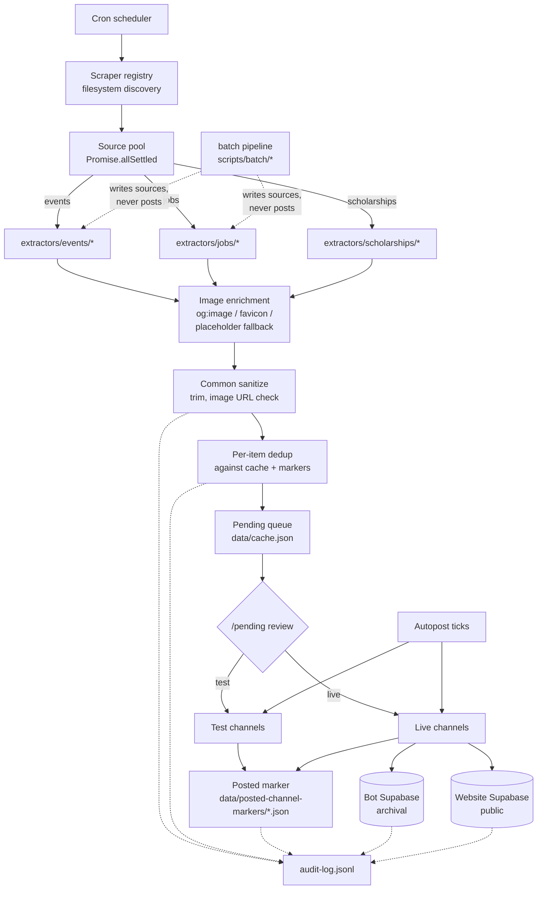
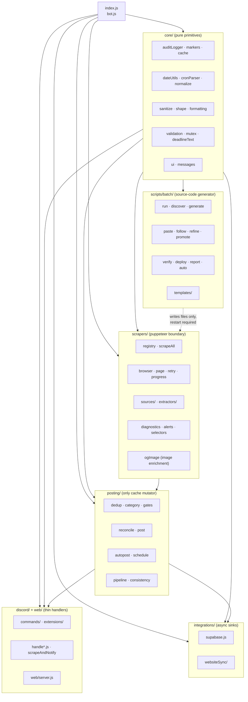

# Pulchowk Events Aggregator

<div align="left">


**Scrapes events, jobs, and scholarships across Nepali and international sources, deduplicates them, publishes to Discord, and syncs to a public website.**


| Sources | Categories | Delivery |
|---|---|---|
| **68 sources**<br/><sub>4 events · 62 jobs · 2 scholarships<br/>recount with `ls src/scrapers/extractors/*/ \| wc -l`</sub> | **9** routed<br/><sub>sports, software, hardware, gaming, music, business, misc, jobs, scholarships</sub> | **3** targets<br/><sub>Discord test · Discord live · Supabase website</sub> |

[Architecture](#architecture) · [Quickstart](#quickstart) · [CLI](#command-line-tool) · [Setup wizard](#setup-wizard) · [Adding a source](#adding-a-source) · [Batch onboarding](#batch-onboarding) · [Docs](#documentation) · [Issues](https://github.com/pulchowk-events/aggregator/issues)

</div>

---

## Contents

- [Overview](#overview)
- [Features](#features)
- [Sources supported](#sources-supported)
- [Architecture](#architecture)
- [Quickstart](#quickstart)
- [Command-line tool](#command-line-tool)
- [Setup wizard](#setup-wizard)
- [Adding a source](#adding-a-source)
- [Batch onboarding](#batch-onboarding)
- [Discord commands](#discord-commands)
- [Configuration](#configuration)
- [Repository layout](#repository-layout)
- [Documentation](#documentation)
- [Limitations](#limitations)
- [License](#license)

---

## Overview

Events, jobs, and scholarship calls are posted across dozens of sites in Nepal — Khalti, KataJaam, NepVents, Kgarira, SathiJob, InternSathi, MeroJob, KumariJob, ScholarshipsAds, EACEA, plus the careers pages of dozens of companies — each with its own page structure, its own taxonomy, its own idea of what "date" means. Keeping a Discord server and a website current against all of them by hand is not tractable.

This bot automates the whole loop. On a cron it scrapes every configured source in parallel through a headless browser, classifies each item into a category, deduplicates against a durable on-disk marker per (item, channel) pair, queues new items for human review, posts them on demand or on an autopost schedule, archives posted items to a Supabase project, mirrors a curated subset to the public website's Supabase, and audits every decision into an append-only local JSONL file.

The **batch pipeline** (`scripts/batch/`) exists because the source set keeps growing and hand-writing every extractor doesn't scale. Sources are maintained in one of two ways — hand-maintained (a human who understands the site fixes it by hand when it drifts) or batch-maintained (produced by the pipeline, regenerated via `batch refine` when it drifts). Both origins produce identical two-file sources and run through the same `runSource()` orchestrator; the split only matters for which repair path to use. New sources can be onboarded in batches of 30–80 URLs at a time: discover, classify, generate (template or LLM prompt), verify, refine, deploy. The batch is a source-code generator — it writes files into `src/scrapers/` at deploy time and never participates in the runtime item lifecycle.

## Features

- **A source is two files.** Adding a website to scrape is: create `src/scrapers/sources/<type>/<name>.js` (five-line wrapper), then `src/scrapers/extractors/<type>/<name>.js` and implement `extract()`. The registry discovers both at boot. Nothing in `src/core/`, `src/posting/`, or `src/discord/` needs to know the source exists. The batch pipeline produces the same two files — the wrapper and extractor are identical whether a source was written by hand or produced by the pipeline.

- **A batch pipeline for onboarding dozens of sources.** `pulchowk-events batch run urls.txt --run mybatch` fetches every URL, classifies the site shape, renders deterministic templates for the four supported ATS families (Workable, Personio, SmartRecruiters) and single-page HTML listings, writes LLM prompts for everything else, verifies the generated extractors against the live site in parallel, and refines LLM-origin failures with their own failure logs. The only human step is the paste round-trip: `paste` copies each prompt to the clipboard, you paste into DeepSeek, copy the reply back, and the loop advances.

- **Two-way LLM loop.** Every prompt asks the LLM to declare a verdict before writing code: `CAREERS_PAGE`, `NOT_CAREERS_PAGE`, or `CAREERS_PAGE_REDIRECT -- <url>`. A redirect verdict is followed inline — the batch dumps the target URL, regenerates the prompt, and continues the site's loop without the user needing to do anything. A not-careers verdict is recorded and the site lands in a terminal bucket with the reason. Failure-mode classification for verification is not a raw code — every reason (`dom_drift_listing`, `low_precision`, `empty-wizard`, `no_image`, `already_posted`) has a `{ label, explanation, fix }` entry that renders in plain English at the terminal.

- **Fail-closed duplicate prevention.** Every (item, channel) post is guarded by a marker file on disk. Markers carry a `postedAt` timestamp when the send succeeds. If the process crashes between confirming the marker and removing the item from the pending queue, the next startup reconciles it. If a marker's heartbeat is stale, the bot checks Discord itself before re-posting. Duplicates become near-impossible, at the cost of the rare skip — the correct trade-off for a community feed.

- **Test → live promotion gate.** Autopost can post only to test channels, letting a human eyeball each item before it goes live. Live posts are further constrained to a 6 AM–10 PM Nepal-time window because live posts ping roles, and 3 AM pings burn goodwill.

- **Drift detection in the scraper layer.** Every source reports `{ items, meta }` where `meta` carries `listingHits`, `detailPagesVisited`, `detailParseFailures`, and `looksBlocked`. When a run returns zero items, the classifier (`classifyOutcome` in `src/scrapers/diagnostics.js`) distinguishes between "genuinely empty" (fine), "the listing selector is stale" (drift at listing), "the detail selector is stale" (drift at detail), and "the site blocked us" (captcha / Cloudflare). Silent zeros become actionable signals.

- **Empty-vs-drift discrimination.** A `dom_drift_listing` failure normally means the extractor couldn't find the page it expected. But "the site has no jobs this week" produces the same zero-item outcome. The batch verifier compares the extractor's output against the discovery-time dump: if the dump showed no plausible job group, the extractor returning zero is correct behavior and the site passes as `empty-wizard`. Only if the dump *did* show job content does the extractor's zero become a real drift failure.

- **Resilient selectors, not brittle ones.** Field extractions known to be unstable go through `pickOne` / `pickAll` (`src/scrapers/selectors.js`) with a fallback chain. When a site changes its card class, one selector stops matching and the bot logs a drift warning the moment a fallback fires, then continues working through minor class shuffles.

- **Image enrichment for jobs.** Job postings rarely carry a per-item image. The orchestrator derives a per-site image from `<meta og:image>` (cached for 30 days per domain in `data/og-image-cache.json`), falls back to the site favicon, and finally to a generated placeholder PNG (`scripts/generate-placeholders.js`: black background, white company name, auto-shrinking font for long names). Placeholders are served from the bot's own Express server at `127.0.0.1:${WEB_PORT}/placeholders/<name>.png`. No job extractor needs to handle image extraction — it's uniform across every job source.

- **Human-readable everything.** Every reason code in the pipeline maps to a `{ label, explanation, fix }` entry in `src/core/messages.js`. Every phase that prints status — scrape, post outcomes, sync batches, batch verify — uses the shared `src/core/ui.js` primitives (banners, tags, result rows, summaries) so the terminal reads as one coherent voice. A user reading a failure sees *"Page layout not recognized — When discovery first visited this page, it could not confidently identify a list of job listings. Next step: Run `batch refine --only <site>`."* Not `dom_drift_unknown_shape`.

- **Audit-first.** `auditLog()` writes a line to `data/audit-log.jsonl` unconditionally. The Discord mirror is best-effort and never blocks the caller. A Discord outage can never mean zero record exists. Every dedup decision, every post outcome, every Discord API error is logged with the full payload — the local file is the forensic source of truth, not Discord. The batch pipeline has its own audit surface (`data/batch/<run-id>/audit.jsonl`) with the same append-only discipline, tuned for pipeline debugging.

- **Two-tier delivery.** Every item type has two delivery tracks: a bot archival Supabase (service-role, full records) and the public website's Supabase (a curated subset filtered by `hasValidImage`, data-quality warnings, and a user-collision check). The two are independent — either can fail without affecting the other, and either can be dry-run independently.

- **One CLI entry point.** `pulchowk-events` — installed via `npm link` or `npm install -g .`, or run as `node scripts/cli.js <cmd>` — dispatches to every operator surface: `setup`, `add`, `fix`, `diagnose`, `verify`, `batch`. Each subcommand is a thin subprocess wrapper, so the TUI, prompts, and signal handling behave identically to running the underlying script directly.

- **Guided wizards.** Three interactive flows. The setup wizard (`scripts/setup/`) walks a fresh deployment end-to-end and has a `--demo` mode that runs the entire flow with mock data and writes nothing outside `data/demo-setup.env`. The source wizard (`scripts/wizard/`) scaffolds a new scraper against an LLM prompt. The batch pipeline (`scripts/batch/`) extends the wizard pattern to N sources at once with checkpointed phases. All three fall back to a plain-text recipe when stdin isn't a TTY.

## Sources supported

The current set: **68 sources total — 4 events, 62 jobs, 2 scholarships.** The list grows over time; the numbers in the hero table and this section reflect the repository at the time of writing.

To recount from the filesystem:

```bash
ls src/scrapers/extractors/events/*.js | wc -l          # event sources
ls src/scrapers/extractors/jobs/*.js | wc -l            # job sources
ls src/scrapers/extractors/scholarships/*.js | wc -l    # scholarship sources
```

For a per-run view of sources staged in a batch but not yet deployed, `pulchowk-events batch status`.

Every source is two files: `src/scrapers/sources/<type>/<name>.js` (the 5-line wrapper) and `src/scrapers/extractors/<type>/<name>.js` (the DOM work). The registry discovers both at boot. Nothing in `src/core/`, `src/posting/`, or `src/discord/` needs to change when a source is added.

Per-source structural details (extraction strategy, known limitations, drift history) and the repair path when a source drifts are documented in [`docs/scrapers.md#reference-current-sources`](docs/scrapers.md#reference-current-sources) and [`docs/scrapers.md#when-a-source-drifts`](docs/scrapers.md#when-a-source-drifts).

### Events (4)

| Source | Site |
|---|---|
| Khalti | `events.khalti.com` |
| KataJaam | `katajaam.com` |
| NepVents | `nepvents.com` |
| Kgarira | `kgarira.com` |

### Jobs (62)

| Source | Careers page |
|---|---|
| SathiJob | `sathijob.com` |
| InternSathi | `internsathi.com` |
| MeroJob | `merojob.com` |
| KumariJob | `kumarijob.com` |
| Aarambha IT | `aarambhait.com` |
| Aayulogic | `aayulogic.com/careers/` |
| Adex International | `adex.ltd/` |
| Aegis Software | `aegishms.com/careers` |
| Agile Solutions | `agile.com.np/careers/` |
| Alpas Technology | `alpastechnology.com/careers` |
| Bajra Technologies | `bajratechnologies.com/` |
| Black Tech | `blacktech.com.np/career` |
| Cedar Gate Technologies | `cedargate.com/careers-2/` |
| Cloco Nepal | `cloco.com.np/careers/` |
| CloudFactory | `cloudfactory.com/careers` |
| CloudTechService | `cloudtechservice.com/careers` |
| Daraz | `careers.daraz.com/` |
| Dev | (see extractor's `LISTING_URL`) |
| Devfinity | `devfinity.io/careers/` |
| DishHome | `career.dishhome.com.np/` |
| DLytica | `dlytica.com/career/` |
| Docsumo | `docsumo.com/careers/` |
| E-Digital Nepal | `edigitalnepal.com/careers/` |
| Ekbana | `careers.ekbana.com/` |
| Eminence Ways | `eminenceways.com/` |
| ESignature | `esignature.com.np/` |
| Evolve | `evolveasia.co/` |
| F1Soft International | `career.f1soft.com/` |
| Fonepay | `fonepay.com/` |
| Genese Solution | `genesesolution.com/` |
| GrowByData | `growbydata.com/` |
| Gurkhatech | `gurkhatech.com/careers/` |
| Hazesoft | `hazesoft.co/careers/` |
| Hitachi (Pioneer Solutions) | `careers.hitachi.com/` (Nepal filter) |
| HiTech Solutions & Services | `hitechnepal.com.np/career/` |
| InfoDevelopers | `infodev.com.np/careers/` |
| Intuji | `intuji.com/careers/` |
| Leapfrog Technology | `career.lftechnology.com/` |
| Lunover Digital | `lunover.com/` |
| Manaram Technology | `manaram.group/` |
| MarginTop Solutions | `margintopsolutions.com/careers` |
| Naxa | `naxa.com.np/` |
| Nep Tech Pal | `neptechpal.com.np/careers/` |
| Nimble Infosys | `career.nimble.com.np` |
| Progressive Labs | `progressivelabs.tech/careers/` |
| Proshore | `proshore.eu/careers/` |
| Quickfox Technologies | `quickfoxconsulting.com/careers/` |
| Skybase Innovations | `skybase.com.np/careers` |
| SoftNEP | `softnep.com/careers` |
| Source Code | `sourcecode.com.np/join-us/` |
| Sustainable Solutions (Sussol) | `sussol.net/jobs/` |
| Tech101 | `tech101.com.np/` |
| Technorio | `technorio.com/career/` |
| TeslaTech | `teslatech.com.np/` |
| UXCam | `uxcam.com/careers/` |
| Vianet Communications | `vianet.com.np/careers/` |
| Vivasoft Nepal | `vivasoft.com.np/careers/` |
| Viveka Health | `vivekahealth.com/careers/` |
| Vrit Technologies | `vrittechnologies.com/careers/` |
| Worldlink Communications | `worldlink.com.np/career/` |
| Yarsa Labs | `yarsalabs.com/` |
| Ycotek (LIS Nepal) | `ycotek.com/careers` |

### Scholarships (2)

| Source | Site |
|---|---|
| ScholarshipsAds | `scholarshipsads.com` |
| Erasmus Mundus | `eacea.ec.europa.eu` |

Full per-source deep dive (structural quirks, drift history, extraction strategy, batch operating model): [`docs/scrapers.md`](docs/scrapers.md). For the batch pipeline itself: [`docs/batch.md`](docs/batch.md).

## Architecture



Three properties the diagram is designed to make obvious: **one entry path into the cache** (only `processScrapedEvents` pushes items), **one entry path out** (only `postEventToCategory` sends Discord messages), and **one audit surface** (every decision writes through `auditLog`). Every module boundary in the repo exists to preserve those three properties. The batch pipeline is deliberately outside the runtime — it produces source files but never touches the cache, markers, or Discord directly.

For the full mental model — the eleven-stage lifecycle of an item, the startup sequence, why `src/core/` is pure functions while `src/posting/` owns cache mutations, the four load-bearing chokepoints, and why the batch pipeline is a source-code generator rather than a runtime participant — see [`docs/architecture.md`](docs/architecture.md).

## Quickstart

```bash
git clone https://github.com/pulchowk-events/aggregator.git
cd aggregator
npm install
npm link                      # optional — installs `pulchowk-events` on PATH
cp .env.example .env
# fill in: DISCORD_TOKEN, HOME_GUILD_ID, LOGS_CHANNEL_ID, AUDIT_LOG_CHANNEL_ID,
#          category channel IDs, Supabase credentials
npm start
```

Node 18+ required. Puppeteer downloads Chromium (~150 MB) on install; set `BROWSER_EXECUTABLE_PATH` and `BROWSER_USER_DATA_DIR` in `.env` to use an existing browser instead (Windows deployments — see [Configuration](#configuration) for the WSL2 caveat).

To fill `.env` interactively instead of by hand, use the [setup wizard](#setup-wizard). To keep the process running in production (systemd / Task Scheduler / pm2), see [`docs/operations.md#keeping-the-process-alive`](docs/operations.md#keeping-the-process-alive).

Verify any single source in isolation before trusting a full scrape:

```bash
pulchowk-events verify scholarshipsads
pulchowk-events verify katajaam
```

`pulchowk-events` is the CLI dispatcher (see [Command-line tool](#command-line-tool)); without an install, `node scripts/verify-source.js <name>` runs the same script directly. This runs the extractor against the live site — no bot, no Discord, no cron — and prints item count, verdict, and a sample.

## Command-line tool

`pulchowk-events` is the front door for every interactive script in the repo. Install once with `npm link` (dev) or `npm install -g .` (prod); the same entry point is callable as `node scripts/cli.js <cmd>` with no install.

| Command | Purpose |
|---|---|
| `pulchowk-events setup` | Walk a fresh deployment end-to-end (.env, Discord channels, Supabase) |
| `pulchowk-events add <url> --type <type>` | Scaffold a single new scraper source (LLM-assisted, guided) |
| `pulchowk-events fix [name]` | Diagnose drift and auto-fix if unambiguous; `fix all` sweeps every source |
| `pulchowk-events diagnose <name>` | Report broken selectors for one source; `--full` also runs the extractor; `--fix --apply` writes suggested patches |
| `pulchowk-events verify <name>` | Run one source's extractor against the live site (the unit test) |
| `pulchowk-events batch run <urls> [--run <id>]` | Full pipeline for 3+ sources in one command with per-phase checkpointing |
| `pulchowk-events batch <subcommand>` | Individual batch phases: `init`, `discover`, `generate`, `check`, `paste`, `follow`, `refine`, `promote`, `verify`, `deploy`, `report`, `status` |
| `pulchowk-events help` / `version` | List commands / print package version |

No shared state, no daemon mode — one command, one process, one task. Set `NO_COLOR=1` to disable ANSI output. Each subcommand maps 1:1 to an underlying script under `scripts/`; the deep dive lives in [`docs/scrapers.md`](docs/scrapers.md), [`docs/batch.md`](docs/batch.md), and [`docs/operations.md`](docs/operations.md).

## Setup wizard

For a fresh deployment from zero, the setup wizard walks the entire flow interactively: Discord token → guild selection → category channel pick/create → logs/audit/alerts channels → ping roles → Supabase (both projects) → dashboard key → browser profile → `.env` write (with backup + diff preview) → optional boot test. Reached via `pulchowk-events setup` or the underlying script.

```bash
# Walk the entire flow with mock data (never touches .env, Discord, or Supabase)
pulchowk-events setup --demo
# or: node scripts/setup/index.js --demo

# Real setup
pulchowk-events setup
# or: node scripts/setup/index.js
```

Every step asks before doing anything. Every side effect is opt-in. `.env` is never written without showing a diff and confirming. The demo mode writes to `data/demo-setup.env` (gitignored) so you can inspect the output without committing anything.

After setup completes, every committed source in `src/scrapers/` is available to the bot — nothing more to install. The registry discovers them on first boot. To onboard more sources later, see [Batch onboarding](#batch-onboarding).

Full walkthrough of every step, what it writes, and how to undo: [`docs/operations.md#setup-wizard`](docs/operations.md#setup-wizard).

## Adding a source

How you add a source depends on how many you're adding. One or two → wizard or manual. Three or more → batch.

### One or two sources: wizard

```bash
pulchowk-events add <url> --type events
# or: node scripts/wizard/index.js <url> <name> <type>
```

This dumps the site's DOM structure, classifies its shape (`jsonld-first` / `listing-to-detail` / `single-page-cards`), writes a ready-to-paste prompt for DeepSeek / ChatGPT / Claude, and walks you through pasting the LLM's code back in — with an automatic verify step at the end.

### One or two sources: manual

Adding a new source by hand is a two-file operation. No change to `src/core/`, `src/posting/`, or `src/discord/` is needed.

**1. The wrapper** at `src/scrapers/sources/<type>/<name>.js`:

```js
const { runSource } = require('../_orchestrate');

module.exports = {
    name: 'mynewsite',
    type: 'events',
    scrape: (ctx) => runSource('mynewsite', 'events', ctx)
};
```

**2. The extractor** at `src/scrapers/extractors/<type>/<name>.js`:

```js
module.exports = {
    async extract(page, { progress, meta }) {
        // All browser work here. Return { items, meta }.
        // The orchestrator handles: browser lifecycle, retry, common
        // sanitization, description trim, image URL validation,
        // image enrichment (og:image / favicon / placeholder), and
        // diagnostic classification. Do NOT duplicate that here.
        return { items, meta };
    }
};
```

Commit both. Verify:

```bash
pulchowk-events verify mynewsite
# or: node scripts/verify-source.js mynewsite
```

When it returns `verdict: ok` with `items > 0`, the source is live. The registry discovers it on the next scrape run.

### Three or more sources: batch

```bash
pulchowk-events batch run urls.txt --run mybatch
```

See [Batch onboarding](#batch-onboarding) below.

Full walkthrough (both manual and wizard paths, plus the drift-fixing playbook): [`docs/scrapers.md#adding-a-source-manual`](docs/scrapers.md#adding-a-source-manual) and [`docs/scrapers.md#adding-a-source-guided`](docs/scrapers.md#adding-a-source-guided).

## Batch onboarding

For adding many sources at once. The batch pipeline is a source-code generator: it produces files under `src/scrapers/`, verifies them against the live site, and asks for the LLM round-trip paste step. It does not participate in the runtime item lifecycle — after deploy, the running bot only sees the new sources when it restarts.

```bash
# 1. Prepare URLs (one per line)
cat > /tmp/new-companies.txt << 'EOF'
https://company-a.com/careers
https://company-b.com/jobs
...
EOF

# 2. Run the whole pipeline — one command, per-phase checkpointing
pulchowk-events batch run /tmp/new-companies.txt --run 2026-11-15-companies

# 3. Review + commit the deployed extractors
git status src/scrapers/
git add src/scrapers/extractors/jobs/ src/scrapers/sources/jobs/
git commit -m "feat(scrapers): add N batch-generated job sources"

# 4. Restart the bot so it picks up the new sources
```

The pipeline runs these phases in order, skipping any whose work is already done:

| Phase | What it does |
|---|---|
| `init` | Create the run directory, snapshot `src/scrapers/` state, seed `urls.txt` |
| `discover` | Fetch every URL in parallel, classify site shape, follow career-page hints, reject dead links |
| `generate` | Render templates for ATS and single-page HTML listings; write LLM prompts for everything else |
| `check` | Validate every prompt against the canonical structure so a `prompt.js` edit can't silently degrade future extractors |
| `paste` | Interactive clipboard loop through every prompt. Handles `NOT_CAREERS_PAGE` and `CAREERS_PAGE_REDIRECT` verdicts automatically |
| `auto` | Verify → classify failures → refine/promote → paste → verify. Loops until every site reaches terminal state |
| `deploy` | Copy verified-passing extractors into `src/scrapers/` with wrappers, syntax-check each file, refuse to overwrite existing |
| `report` | Bucket every site into PASS / REJECT / LLM-NOT-CAREERS / FAIL-* with human-readable labels |

The two-way LLM loop is what makes the batch usable on real URLs. Every prompt asks the LLM to declare a verdict before writing code — `CAREERS_PAGE`, `NOT_CAREERS_PAGE`, or `CAREERS_PAGE_REDIRECT -- <url>`. A redirect verdict is followed inline; a not-careers verdict is recorded with the reason and the site is dropped. Only genuinely wrong URLs (Facebook pages, 404s, dead domains) need human intervention, and those are surfaced with clear reasoning.

For the full pipeline reference — state machine, phase commands, template vs prompt selection, empty-vs-drift discrimination, refine/promote, deploy safety — see [`docs/batch.md`](docs/batch.md). For batch operations (inspecting runs, cleaning up old directories, refreshing drifted sources): [`docs/operations.md#batch-pipeline-operations`](docs/operations.md#batch-pipeline-operations).

## Discord commands

All commands are guild-scoped to `HOME_GUILD_ID` and require Discord's `ADMINISTRATOR` permission. There is deliberately no global registration — adding the bot to a foreign guild grants no access.

### Scraping and queue

| Command | Purpose |
|---|---|
| `/scrape [site]` | Manually trigger a scrape (all sources, or one) |
| `/pending [type]` | List pending items with per-item action buttons |
| `/preview <query>` | Render how a pending item will look when posted |
| `/restore <query>` | Bring a skipped item back to pending |
| `/cleanup <type> [source]` | Bulk-remove cached items by type and/or source |

### Posting control

| Command | Purpose |
|---|---|
| `/autopost start-test` / `start-live` | Start autopost for events, jobs, scholarships, or any combination |
| `/autopost stop` | Stop autopost per track/mode |
| `/autopost set-interval` | Change posting interval (0 = back-to-back) |
| `/autopost status` | Show active tracks and intervals |
| `/undo [query]` | Delete a live post and restore the item to pending |
| `/edit-live <query>` | Edit a live message's fields in place |

### Channel and category control

| Command | Purpose |
|---|---|
| `/category pause` / `resume` | Temporarily block a category from going live |
| `/blacklist add/remove/list` | Auto-skip scraped items by keyword or organizer |
| `/ping on/off/add/remove/category` | Control role pings on live posts |

### Sync and delivery

| Command | Purpose |
|---|---|
| `/supabase sync-now` | Upload unsynced posted items to the bot archival Supabase |
| `/supabase republish-all` | Force re-upload the entire posted-events cache |
| `/supabase autosync-start` / `stop` | Interval-based auto-sync |
| `/website-sync now` | Immediate public-site sync (events + jobs + scholarships) |
| `/website-sync health` | Diff the bot's eligible set against the website |
| `/website-sync prune` | Force-delete orphans (bypasses threshold guard) |

### Diagnostics and maintenance

| Command | Purpose |
|---|---|
| `/status` | Pending/posted/skipped counts, autopost tracks, next scrape time |
| `/health` | Permission check across every configured channel |
| `/stats [days]` | Posting volume from the marker files |
| `/uptime` | Process uptime, memory, version |
| `/find <query>` | Search pending/posted/skipped/archived items by title |
| `/backup` | Download the current `cache.json` |
| `/clear-skipped` | Empty the in-memory skipped list |
| `/dedupe [channel] [limit]` | Scan live channels for duplicate messages and remove extras |
| `/publish-previous` | Retroactively dedupe + crosspost past live posts |
| `/autopublish on/off/status` | Auto-crosspost new posts after dedupe clears them |
| `/settings set-logs` / `set-schedule` / `set-lead-days` / `set-needs-attention-expiry-days` / `toggle-missed-scrape-catchup` | Persistent configuration overrides |
| `/shutdown` | Stop autopost and exit the process (for supervisor-managed restarts) |

## Configuration

Two independent config layers, both loaded at boot.

**Secrets and deployment identifiers — `.env`** (see [`.env.example`](.env.example)). Read via `src/config/env.js`, validated at startup. Every missing value produces a named warning rather than a silent `undefined`. Key vars:

| Var | Purpose |
|---|---|
| `DISCORD_TOKEN` | Bot login token |
| `HOME_GUILD_ID` | The one guild the bot answers in — every command checks this |
| `LOGS_CHANNEL_ID` | Curated human-facing feed — scrape progress, post results |
| `AUDIT_LOG_CHANNEL_ID` | Exhaustive audit trail mirror |
| `ALERTS_CHANNEL_ID` / `ALERTS_PING_ROLE_ID` | Time-sensitive source-failure alerts (optional) |
| `*_CHANNEL_ID` (one pair per category) | Main + test channel for each of the 9 categories |
| `JOBS_PING_ROLE_ID` / `SCHOLARSHIPS_PING_ROLE_ID` | Optional ping roles for those categories |
| `SUPABASE_URL` + `SUPABASE_SERVICE_ROLE_KEY` | Bot archival Supabase |
| `WEBSITE_SUPABASE_URL` + `WEBSITE_SUPABASE_SERVICE_ROLE_KEY` | Public website Supabase |
| `WEBSITE_SYNC_DRY_RUN` | `true` to preview website changes without writing |
| `SCRAPE_CRON` | Cron schedule for the scrape loop (default `0 */6 * * *` — every 6 hours) |
| `WEBSITE_SYNC_CRON` | Cron schedule for the website sync loop (default `0 * * * *` — hourly) |
| `WEB_PORT` | Express dashboard port. Also used to construct placeholder-image URLs (`http://127.0.0.1:<port>/placeholders/<name>.png`) for job image enrichment |
| `DASHBOARD_API_KEY` | Bearer token for `/api/*`; mutating routes are unauthenticated if unset |
| `WEBSITE_*_TABLE` | Table name overrides for the website project (`events`, `jobs`, `scholarships` by default) |
| `BROWSER_EXECUTABLE_PATH` + `BROWSER_USER_DATA_DIR` | Windows-only: real browser + warm profile for Cloudflare/login-required sites |

**Server-specific non-secrets — `src/config/`.** Emoji IDs and ping role IDs live here so a forker can swap servers by editing three files, not re-running `.env` setup:

- `emojis.js` — all custom emoji references. Replace with your server's emoji IDs (right-click → Copy ID with Developer Mode on).
- `roles.js` — ping role IDs for the 7 hardcoded categories. Jobs and scholarships read from `.env`.
- `constants.js` — behavioural tunables: fuzzy thresholds, live-window hours, cache caps, retention periods, keyword dictionaries, safety note text.

**Note on `BROWSER_EXECUTABLE_PATH`:** the path is host-specific. Windows deployments resolve `C:/Program Files/...` fine. WSL2 or native Linux deployments can't resolve Windows paths and fall back to bundled Chromium — this is intentional fail-soft, not a bug. If you need a warm profile on WSL2, install native Chromium instead.

Full env var reference, tuning constants, and per-file forking notes: [`docs/operations.md#configuration-reference`](docs/operations.md#configuration-reference).


## Repository layout

Two views of the same thing: a grouped tree for orientation, then a dependency diagram showing how the layers connect. The tree lists files grouped by **what they do**, not alphabetically — a flat 40-file list has no shape, but grouping by concern makes the pattern visible.

### Directory tree

`src/` contains the seven application layers. Each has a single responsibility — see [`docs/architecture.md#module-boundaries`](docs/architecture.md#module-boundaries) for the rules about what each layer can touch.

```text
src/
├── index.js                entry — constructs EventsBot, attaches extensions, starts
├── bot.js                  EventsBot class (composition root)
│
├── config/                 static data (read by every layer)
│   env · constants · roles · emojis
│
├── core/                   pure primitives (no bot instance)
│   ├── state & IO            auditLogger · markers · cache
│   ├── math & text           dateUtils · cronParser · normalize · deadlineText
│   ├── field cleanup         sanitize · shape
│   ├── output & control      formatting · validation · mutex
│   └── shared UI             ui · messages
│
├── scrapers/               puppeteer boundary (produces {items, meta})
│   ├── plumbing              browser · page · retry · text · progress
│   ├── quality               selectors · diagnostics · alerts
│   ├── image enrichment      ogImage
│   ├── domain                jobs · scholarships
│   ├── orchestration         registry · scrapeAll
│   ├── sources/              one 5-line wrapper per source (committed)
│   └── extractors/           one DOM file per source (committed)
│
├── posting/                only layer that mutates cache
│   ├── pure predicates       dedup · category · gates
│   ├── post pipeline         reconcile · post
│   ├── scheduling            autopost · schedule
│   └── pipeline + drift      pipeline · consistency
│
├── discord/                thin transport adapters
│   ├── admin · onReady · interaction · customId
│   ├── handle{Button,CategorySelect,ConfirmPost,ModalSubmit}.js
│   ├── scrapeAndNotify · sendPendingEventsMessage
│   ├── commands/             7 base slash commands + register
│   └── extensions/           ~9 extension modules + index
│
├── web/                    HTTP surface
│   └── server.js             express + /api/* + /placeholders/:name
│
└── integrations/           outbound async sinks
    ├── supabase.js           bot archival sync
    └── websiteSync/          public-site sync
        engine · commands · index
```

Supporting directories, outside `src/`:

```text
scripts/
├── cli.js                  pulchowk-events binary — dispatches to the rest
├── diagnose.js             selector-level drift diagnosis
├── verify-source.js        run one scraper in isolation (the "unit test")
├── generate-placeholders.js one-shot: render 1024×1024 placeholder PNGs per source
├── setup/                  interactive setup wizard
│   index · adapters · discord · discord-create
│   env-writer · supabase · validators
├── wizard/                 new-source wizard + drift-fix entry
│   index · dump · detect · prompt · templates
│   tui · interactive · fix · browser
├── batch/                  multi-source pipeline
│   run · index · discover · generate · classify · paste · follow
│   refine · promote · verify · verify-worker · deploy · report · auto
│   lib/   audit · heartbeat · llm-header · messages(shim) · naming · paths
│          preflight · prompt-structure · snapshot · ui(shim) · url-resolve
│   templates/   workable · personio · smartrecruiters · html-cards-listing
├── shared/platform.js      cross-wizard helpers (clipboard, URL open)
└── maintenance/            one-shot migration + cleanup tools

docs/
├── architecture.md         mental model, module boundaries, chokepoints
├── scrapers.md             scraper plugin system + drift playbook
├── batch.md                batch pipeline — state machine, phases, two-way loop
└── operations.md           deployment, config, troubleshooting, backups

data/                       runtime state (gitignored)
├── cache.json              pending/posted/skipped/expired events, settings
├── audit-log.jsonl         rolling window of decisions
├── posted-channel-markers/ one marker per (item, channel) pair
├── og-image-cache.json     per-domain og:image URLs, 30-day TTL
├── placeholder-images/     generated fallback PNGs, one per source
└── batch/<run-id>/         per-batch state — urls, dumps, prompts, results
                            (never read by the running bot)
```

### How the layers depend on each other

Every import flows downward. A layer only imports from the layers below it, never from the layers above. `config/` is read by every layer and imports from none, so it doesn't appear in the graph.



Two consequences worth noting:

- **`scrapers/` only talks to `posting/` through `scrapeAll`'s return value.** A scraper returns `{items, meta}`; it never calls into `posting/` and never touches cache. This is what makes `verify-source.js` possible — the whole scrapers layer can be run in isolation from the posting layer.
- **`discord/` and `web/` are entirely thin.** Every mutation they trigger goes through a `posting/` function; every read goes through a `core/` or a `bot.*` accessor. There's no cache write, no marker reservation, no dedup decision inside a handler. That's why both can be tested by booting the bot and clicking buttons — the handler is just a transport, the logic is elsewhere.
- **`scripts/batch/` writes into `scrapers/` and nothing else.** It's a source-code generator; it doesn't import from `posting/`, `discord/`, `web/`, or `integrations/`. The batch pipeline has its own audit surface and its own state directory. The only runtime-visible side effect is that new extractor files appear on disk, which the running bot won't see until restart.

### Where a specific file lives

| You're looking for… | Open |
|---|---|
| The single function that sends Discord posts | `posting/post.js` |
| The dedup key computation | `posting/dedup.js` |
| The scrape orchestrator | `scrapers/scrapeAll.js` |
| The plugin registry | `scrapers/registry.js` |
| The audit-trail writer | `core/auditLogger.js` |
| The marker reserve/confirm cycle | `core/markers.js` |
| The image enrichment helper | `scrapers/ogImage.js` |
| The autopost tick loop | `posting/autopost.js` |
| The slash command dispatcher | `discord/commands/index.js` |
| The extension router (post hooks, buttons) | `discord/extensions/index.js` |
| The Supabase archival sync | `integrations/supabase.js` |
| The website sync engine | `integrations/websiteSync/engine.js` |
| The shared UI primitives | `core/ui.js` |
| The human-readable message catalogue | `core/messages.js` |
| The batch pipeline entry point | `scripts/batch/run.js` |
| The batch phase dispatcher | `scripts/batch/index.js` |

## Documentation

Five docs, each scoped to one audience.

| Doc | Audience | What's inside |
|---|---|---|
| [`docs/architecture.md`](docs/architecture.md) | Anyone modifying the code | System overview diagram, lifecycle of one item, startup sequence, module boundaries, the four chokepoints, why the batch pipeline is outside the runtime |
| [`docs/scrapers.md`](docs/scrapers.md) | Anyone touching a scraper | Plugin system, extractor contract (including `browserless` and image enrichment), drift classification, fallback chains, `verify-source.js`, `wizard/index.js`, drift-fixing playbook, per-source reference |
| [`docs/batch.md`](docs/batch.md) | Anyone onboarding many sources | State machine, phase commands, template vs prompt selection, two-way LLM loop (verdicts, redirects, refine, promote), deploy safety, run directory layout, failure modes |
| [`docs/operations.md`](docs/operations.md) | Anyone running the bot | Process supervision, full env var reference, tuning constants, monitoring queries, batch pipeline operations, backups, migration, setup wizard, troubleshooting matrix, alerts, log rotation |
| [`CONTRIBUTING.md`](CONTRIBUTING.md) | Anyone opening a PR | The four load-bearing invariants, code style, testing philosophy, commit and PR conventions, how to file a useful bug report |

Read them in the order that matches what you're about to do. If you're modifying code, `architecture.md` first. If you're adding a source, `scrapers.md` first, and `batch.md` if it's part of a larger onboarding. If you're operating the bot, `operations.md` first. If you're opening a PR that touches any of the above, `CONTRIBUTING.md` first — the four chokepoints section is the one thing reviewers will block on.

## Limitations

**Data**

- Scraper sources are third-party sites with no published APIs. Selector drift happens — the `pickOne` fallback chains and `classifyOutcome` diagnostics make drift visible, but they don't prevent it. `pulchowk-events diagnose <name>` and `pulchowk-events fix` make per-source testing and drift repair a one-command operation.
- Some sources are structurally limited. `scholarshipsads` stops at page 1 per category (Cloudflare); `kgarira` returns the same items on each pagination page (deduped downstream, but wastes fetch time). Both are captured accurately (correct items, deduped) — the limitation is throughput, not data.
- The website sync excludes items that fail `hasValidImage` or carry unresolved data-quality warnings. That's intentional (public site quality gate) but it means some real events never reach the site.
- The bot archival Supabase caps at 1000 posted items per type. `republish-all` can only re-upload what's in that window.

**Method**

- Fuzzy dedup (Levenshtein ≥ 0.85) is a *secondary* signal, never standalone. Different sources' wordings of the same event are caught by the exact canonical-date match most of the time; fuzzy catches the rest. Neither is perfect — a title that shifts too far will still produce a duplicate.
- The website user-collision check matches substantive words (≥4 chars, word-boundary, stopwords filtered) on the same date. Titles sharing only common words like "Nepal" or "The" are not treated as collisions.
- The website sync's prune step is destructive by design — it deletes orphan rows. The three guards make accidental mass-delete unlikely, but not impossible: a source returning a wrong-shaped set can still slip past the >50% check if the wrong set is small.
- Empty-vs-drift discrimination uses `jobTitleRatio < 0.3` as its threshold. A site that renames "Software Engineer" to something the classifier doesn't recognize would push the ratio down and get classified as empty. `batch refine --only <site>` gives the LLM a chance to fix it.

**Batch pipeline**

- The paste step is linear and human-paced. Multi-prompt-in-one-chat was considered and rejected — DeepSeek output caps at ~4K–8K tokens, a single extractor is 250–400 lines, and truncating an extractor produces a syntax error that loses the whole reply.
- Template coverage varies by batch. In the companies-76 run, 13 of 76 sites templated (17%). Templates excel when the DOM structure is common — Workable / Personio / SmartRecruiters ATS, or single-page card listings. They fall down on multi-stage navigation and culture-card false positives.
- `refine` stops at 3 attempts per site. A site that genuinely needs a fourth round is not retried automatically — it gets a terminal state and requires `--force` to continue.
- Batch state is per-run — no cross-run reuse. Re-adding a site from a previous batch re-runs discover, generate, and paste for it. There is no "resume from previous run's extractor" optimization.

**Not done**

- No machine translation. Non-English source content is posted as-is.
- No image-host mirroring. Posted images are hotlinked from the source. If the source removes an image, the Discord attachment stays (Discord caches it) but the audit log's reference to it goes stale.
- No source-side rate-limit awareness. A source that starts returning 429 will be caught by the drift classifier as a failure and logged, but not throttled automatically.
- No automated commit after `batch deploy`. The deploy step prints the exact `git add` / `git commit` commands; you review the diff and run them. That's deliberate — the reviewer should see what's being committed.
- No batch mode for events or scholarships. The batch pipeline is hardcoded to job sources because events and scholarships don't have the same URL-discovery problem (they come from event listing sites, not company career pages). Extending to other types would require rethinking the URL resolution layer, not just the template engine.

## License

MIT. See [LICENSE](LICENSE). Emoji and role IDs in `src/config/` are original-server assets and are not covered — replace them when deploying to a different Discord server.