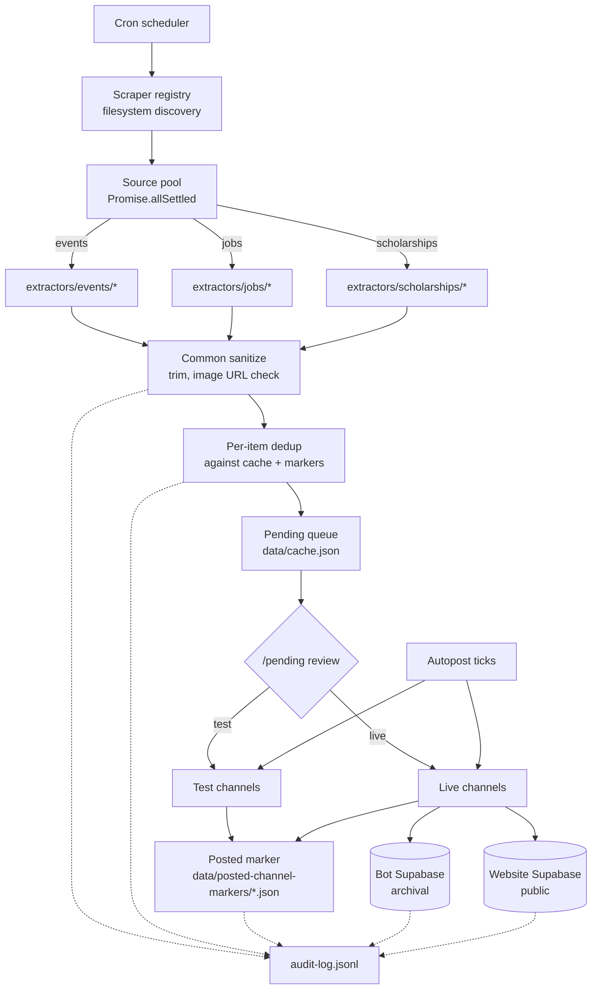

<div align="center">


# Pulchowk Events Aggregator

**Scrapes events, jobs, and scholarships from ten Nepali and international sources, deduplicates them, publishes to Discord, and syncs to a public website.**


| Sources | Categories | Delivery |
|---|---|---|
| **10** scraped<br/><sub>4 events · 4 jobs · 2 scholarships</sub> | **9** routed<br/><sub>sports, software, hardware, gaming, music, business, misc, jobs, scholarships</sub> | **3** targets<br/><sub>Discord test · Discord live · Supabase website</sub> |

[Scraper contract](src/scrapers/extractors/README.md) · [Architecture](#architecture) · [Runbook](#operations) · [Issues](https://github.com/pulchowk-events/aggregator/issues)

</div>

---

## Contents

- [Overview](#overview)
- [What sets it apart](#what-sets-it-apart)
- [Sources supported](#sources-supported)
- [Architecture](#architecture)
  - [Scraper plugin system](#scraper-plugin-system)
  - [Posting pipeline](#posting-pipeline)
  - [Deduplication and durability](#deduplication-and-durability)
  - [Delivery targets](#delivery-targets)
- [Lifecycle of one item](#lifecycle-of-one-item)
- [Quickstart](#quickstart)
- [First run walkthrough](#first-run-walkthrough)
- [Commands](#commands)
- [Configuration](#configuration)
- [Repository layout](#repository-layout)
- [Operations](#operations)
- [Adding a source](#adding-a-source)
- [Troubleshooting](#troubleshooting)
- [Limitations](#limitations)
- [License](#license)

---

## Overview

Events, jobs, and scholarship calls are posted across dozens of sites in Nepal — Khalti, KataJaam, NepVents, Kgarira, SathiJob, InternSathi, MeroJob, KumariJob, ScholarshipsAds, EACEA — each with its own page structure, its own taxonomy, its own idea of what "date" means. Keeping a Discord server and a website current against all of them by hand is not tractable.

This bot automates the whole loop. On a cron it:

1. **scrapes** every configured source in parallel through a headless browser;
2. **classifies** each item into a category (sports, software, hardware, gaming, music, business, misc, jobs, scholarships) using a keyword dictionary plus per-source hints;
3. **deduplicates** against what's already been posted using a durable on-disk marker per (item, channel) pair — markers survive process restarts and are the source of truth, not the in-memory cache;
4. **queues** new items as *pending* for human review, with per-field data-quality warnings surfaced inline;
5. **posts** on demand or on an autopost schedule — to *test* channels first if configured, then to *live* channels during a 6 AM–10 PM Nepal-time window;
6. **archives** posted items to a bot-level Supabase table and mirrors a public subset to the website's own Supabase;
7. **audits** every decision — from scraping to dedup to posting — into a local append-only JSONL file and, best-effort, into a Discord audit channel.

The whole system is built around four principles: every concern lives in exactly one file, every decision is audited, every source is a drop-in plugin, and every "0 items" is distinguishable from every other "0 items".

## What sets it apart

- **A source is one file.** Adding a new website to scrape is: create `src/scrapers/sources/<type>/<name>.js` (five lines), create `src/scrapers/extractors/<type>/<name>.example.js` (a stub), `cp` the stub to `<name>.js` and implement the page-evaluate body. The registry discovers it at boot. Nothing in `src/core/`, `src/posting/`, or `src/discord/` needs to know the source exists.

- **Fail-closed duplicate prevention.** Every (item, channel) post is guarded by a marker file on disk. Markers carry a `postedAt` timestamp when the send succeeds. If the process crashes between confirming the marker and removing the item from the pending queue, the next startup reconciles it. If a marker's heartbeat is stale, the bot checks Discord itself before re-posting. Duplicates become near-impossible, at the cost of the rare skip — which is the correct trade-off for a community feed.

- **Test → live promotion gate.** Autopost can be configured to post only to test channels, letting a human eyeball each item before it goes live. Live posts are further constrained to a 6 AM–10 PM Nepal-time window because live posts ping roles, and 3 AM pings burn goodwill.

- **Drift detection in the scraper layer.** Every source reports `{ items, meta }` where `meta` carries `listingHits`, `detailPagesVisited`, `detailParseFailures`, and `looksBlocked`. When a run returns zero items, the classifier (`classifyOutcome` in `src/scrapers/diagnostics.js`) distinguishes between "genuinely empty" (fine), "the listing selector is stale" (drift at listing), "the detail selector is stale" (drift at detail), and "the site blocked us" (captcha / cloudflare). Silent zeros become actionable signals.

- **Resilient selectors, not brittle ones.** Every field extraction goes through `pickOne` / `pickAll` (`src/scrapers/selectors.js`) with a fallback chain. When KataJaam changed its card class, one selector stopped matching and the bot returned zero events with no error. The current design logs a drift warning the moment a fallback fires, and continues working through minor class shuffles.

- **Audit-first.** `auditLog()` writes a line to `data/audit-log.jsonl` unconditionally. The Discord mirror is best-effort and never blocks the caller. A Discord outage can never mean zero record exists. Every dedup decision, every post outcome, every Discord API error is logged with the full payload — the local file is the forensic source of truth, not Discord.

- **Two-tier delivery.** Every item type has two delivery tracks: a bot archival Supabase (service-role, full records) and the public website's Supabase (browser-client, a curated subset filtered by `hasValidImage`, data-quality warnings, and a user-collision check). The two are independent — either can fail without affecting the other, and either can be dry-run independently.

## Sources supported

| Type | Source | Site | Notes |
|---|---|---|---|
| Events | Khalti | `events.khalti.com` | Single-page DOM harvest, no per-event navigation. Fastest source. |
| Events | KataJaam | `katajaam.com` | Nine category pages × per-event detail. Blur-up placeholder images need an `aria-hidden` filter. |
| Events | NepVents | `nepvents.com` | Three category pages. JSON-LD-first extraction with HTML fallback. Registration URL is discovered by clicking through the site's own button. |
| Events | Kgarira | `kgarira.com` | Three paginated listing pages × per-event detail. Banner image is a CSS `background-image` — inherently fragile. |
| Jobs | SathiJob | `sathijob.com` | Virtualized listing, needs scroll-loop harvesting. Structured stat grid on detail pages. |
| Jobs | InternSathi | `internsathi.com` | Same structural shape as SathiJob. Slug encodes level/employment-type/mode — used as fallback. |
| Jobs | MeroJob | `merojob.com` | Normal server-rendered listing with real pagination. Deadlines are relative ("15 days from now") and are converted to absolute at scrape time. |
| Jobs | KumariJob | `kumarijob.com` | Normal listing with real pagination. Detail pages can apply offsite (LinkedIn, employer ATS). |
| Scholarships | ScholarshipsAds | `scholarshipsads.com` | Listing cards carry everything except deadline — one extra detail-page visit per item to read the real date. |
| Scholarships | Erasmus Mundus | `eacea.ec.europa.eu` | Two-hop scrape. Deadlines are intentionally `unknown` (project duration ≠ application deadline). |

The DOM extraction for each source is *not* in this repository — the repo ships the plugin contract, the orchestration layer, and `.example.js` stubs. See [`src/scrapers/extractors/README.md`](src/scrapers/extractors/README.md).

## Architecture



Every decision point — sanitize, dedup, category, post outcome, Discord error — is a single `auditLog()` call, local-first and Discord-mirrored.

### Scraper plugin system

Sources are discovered from the filesystem at boot:

```
src/scrapers/sources/
├── events/
│   ├── khalti.js       ← exports { name, type, scrape }
│   ├── katajaam.js
│   ├── nepvents.js
│   └── kgarira.js
├── jobs/
└── scholarships/
```

Each file is a five-line wrapper around `runSource()` (`src/scrapers/sources/_orchestrate.js`), which owns:

- Extractor loading (real file first, `.example.js` stub fallback)
- Retry and browser lifecycle
- Common sanitization (description trim, image validation, field clean)
- Result shape `{ items, meta }` consumed by `classifyOutcome()`

The extractor — the piece that contains site-specific DOM knowledge — lives separately at `src/scrapers/extractors/<type>/<name>.js` and is **gitignored**. See [`src/scrapers/extractors/README.md`](src/scrapers/extractors/README.md) for the contract and rationale.

### Posting pipeline

An item flows through these states:

```
scraped → pending → testPosted → posted
                ↘ skipped
                ↘ expired (date passed)
                ↘ needsAttentionExpired (flagged >N days, archived)
```

At each transition, the item is written to `data/cache.json` (debounced, atomic via temp-file-rename). The pipeline is not queue-based — a single mutex serializes cache mutations and posting, so concurrent autopost ticks and manual `/pending` clicks never race.

Post attempts go through a four-way check:

1. Category paused? (`/category pause`)
2. Global ping enabled? (if a ping is requested)
3. For live posts: has a valid image? (scholarships exempt)
4. For live posts: any unresolved data-quality warnings? (a manual `force` bypasses this)

If all pass, a marker file is claimed (`wx` flag — fails if it exists, which is the dedup guarantee). Image is fetched and attached. Success → marker is confirmed (`postedAt` set). Failure → marker is released (deleted).

### Deduplication and durability

Two independent dedup signals run side-by-side:

- **Exact key** — `normalizedTitle|canonicalDate`. Deterministic, cheap, fast. Catches the same item scraped twice.
- **Fuzzy match** — Levenshtein similarity ≥ 0.85 (0.93 for scholarships, because titles share more boilerplate) within the same canonical date. Catches minor wording drift between sources on the same event.

The *authoritative* "was this posted?" answer is never in memory — it's the marker file. On startup the bot reconciles: for any item still in `pendingEvents` that has a confirmed marker, the item is moved to `postedEvents`. On a stale reservation, Discord is queried directly — if the message exists, the reservation is upgraded to confirmed; if the check itself fails (rate limit, permissions, no title), the reservation is treated as *still blocking* (fail closed).

Markers are retained for `MARKER_RETENTION_DAYS` (default 180), then swept by a daily cron.

### Delivery targets

Four downstream targets, independent of each other:

| Target | Purpose | Failure mode |
|---|---|---|
| **Discord (test)** | Human review, no ping | Logs warning; nothing sent |
| **Discord (live)** | Public post, role ping | Logs error; marker released for retry |
| **Bot Supabase** | Archival, service-role, all item types | Batch fails, item remains unsynced, retried next tick |
| **Website Supabase** | Public website, curated subset | Prune aborts on >50% loss, otherwise row-by-row delete |

The website sync is guarded by three safety rails:

- **Empty-scrape guard** — if the eligible set is empty but the website has bot rows, prune aborts (the scrape probably failed).
- **Delete-threshold guard** — if >50% of bot rows would be pruned, abort and alert.
- **User-collision guard** — if a user-submitted event exists on the same date with a similar title, the bot row is skipped (user submissions take precedence).

## Lifecycle of one item

Every item — event, job, or scholarship — goes through the same ten stages. This is the mental model you need to understand everything else in the repo.

**1. Extraction.** A scraper plugin's `extract()` visits the source site through a headless browser and returns an array of raw items, all shaped like events (jobs and scholarships get remapped onto the event shape by `core/shape.js` — see below). The extractor also fills in `meta` counters so a zero-result run can be diagnosed.

**2. Common sanitize.** Every item passes through `sanitizeScrapedEvent()` (in `scrapers/sanitize.js`), which catches fields the scraper mislabeled ("date" containing "🎵Music", "price" containing a category chip). Suspect fields are cleared and a `dataQualityWarning` is added — the item still survives, but it's flagged for human review.

**3. Shape normalization.** `core/shape.js` remaps job/scholarship fields onto the event field names the rest of the pipeline expects (`date` gets the deadline, `image` gets the company logo, etc.). It also sets `itemType: 'job' | 'scholarship'`. From this point on, every downstream stage treats it identically to an event.

**4. Dedup.** `getEventDedupKey()` (in `bot.js`) computes `normalizedTitle|canonicalDate`. The item is compared against every existing cache array (`postedEvents`, `pendingEvents`, `skippedEvents`, `expiredEvents`) plus a fuzzy match against `postedEvents` (Levenshtein similarity). The verdict is written to `audit-log.jsonl` with the full item payload, so a "why wasn't this posted?" question is always answerable after the fact.

**5. Queue.** New items are pushed to `pendingEvents` with `firstSeenAt = now` (used by the needs-attention-expiry sweep). Items may or may not survive the next few stages — the queue is deliberately human-gated.

**6. Review.** A human runs `/pending`, gets an embed per item with four buttons: **Post to Live**, **Post to Test**, **Customize**, **Skip**. Customize opens a modal that overwrites title/description/date/location/image. Skip moves the item to `skippedEvents`. Every choice goes through the audit log.

**7. Post.** `postEventToCategory()` is the single choke point for all posts (manual button, autopost tick, dashboard API). It:

  1. Checks the paused-categories gate, has-valid-image gate, and data-quality-warning gate.
  2. Reserves a marker file (fails if one exists — this is the duplicate block).
  3. Fetches the image (with a 15 s timeout — falls back to text-only if it fails).
  4. Sends to Discord (with or without a role ping, based on the ping settings).
  5. Confirms the marker (`postedAt` set) on success, releases it on failure.
  6. Writes an `auditLog('post_event_outcome', ...)` line either way, so a skipped post is never silent.

**8. State transition.** On successful live post, the item is removed from `pendingEvents` and pushed to `postedEvents`. On successful test post, `testPosted` and `testPostedAt` are set and the item stays pending.

**9. Sync.** Two independent Supabase syncs run in the background:

  - **Bot archival** (`integrations/supabase.js`) — service-role, full item records, batched, retries on failure.
  - **Website** (`integrations/websiteSync.js`) — browser-client key, curated subset filtered by `hasValidImage`, no unresolved warnings, no user-collision. Prune guards prevent accidental mass-delete.

**10. Audit.** Every step above has already written to `data/audit-log.jsonl`. The Discord mirror (best-effort) puts the same entries in the audit channel. This is the forensic record.

## Quickstart

```bash
git clone https://github.com/pulchowk-events/aggregator.git
cd aggregator
npm install
cp .env.example .env
# fill in: DISCORD_TOKEN, HOME_GUILD_ID, LOGS_CHANNEL_ID, AUDIT_LOG_CHANNEL_ID,
#          category channel IDs, Supabase credentials
npm start
```

Node 18+ required. Puppeteer downloads Chromium (~150 MB) on install; set `BROWSER_EXECUTABLE_PATH` and `BROWSER_USER_DATA_DIR` in `.env` to use an existing browser instead.

## First run walkthrough

Assuming `.env` is filled in and `npm start` is running, this is the intended first-run flow.

**1. Verify startup.** The console should show:

```
✅ Bot logged in as <bot-tag>
✅ Slash commands registered to guild <HOME_GUILD_ID> only.
🕒 Automatic scraping scheduled with cron "0 */6 * * *"
🌐 Dashboard available at http://localhost:3001
```

Any `⚠️ Startup configuration warnings:` block lists the env vars that are still empty. Fix them, restart.

**2. Check the health dashboard.** Run `/status` in Discord. You should see pending/posted/skipped counts, autopost tracks all off, and a next-scrape time in the future. If any channel shows "unreachable", the bot lacks permissions there.

**3. Trigger a manual scrape.** Run `/scrape`. It fires the same pipeline the cron would, into the logs channel with a progress bar. When it finishes:

- Every newly-scraped item is added to `pendingEvents`.
- Every item that failed a data-quality check is flagged, but still visible.
- The logs channel gets a follow-up embed per item with the review buttons.

**4. Review the first batch.** Run `/pending`. Walk through every item. For each, either **Customize** (fix a field), **Post to Test** (see how it looks without pinging anyone), or **Skip** (irrelevant / already posted elsewhere).

For a first run, aim to **Post to Test** on 5-10 items and inspect them in your test channels. This is your only chance to catch rendering bugs (bad image URLs, truncated descriptions, missing fields) before live.

**5. Promote to live.** For an item you already test-posted and approved, click **Post to Live** from `/pending`. It posts with a role ping if the ping settings allow it.

**6. Set up autopost.** Once you trust the queue, run `/autopost start-live type:events interval_minutes:60`. This starts an independent 60-minute timer that will post one eligible event from `pendingEvents` each tick. Jobs and scholarships get their own timers — they don't compete.

Posting gates still apply. Anything with a data-quality warning, anything with no valid image (except scholarships), anything within `autopostMinLeadDays` of its date, and anything outside the 6 AM–10 PM window will be skipped. That's the safety net working, not a bug.

**7. Watch the audit log.** Every 15 minutes, tail the log:

```bash
tail -20 data/audit-log.jsonl | jq -r '"\(.level)\t\(.category)\t\(.message)"'
```

If something is skipping when it shouldn't, grep for it:

```bash
jq -r 'select(.category=="autopost_filter_skip") | "\(.data.title)\t\(.data.filter)"' data/audit-log.jsonl | tail -20
```

**8. Tune.** Every behavioural knob is overridable at runtime. The ones you'll adjust most often:

- `/settings set-lead-days N` — minimum days before an event date that autopost will consider it.
- `/ping category category:X state:off` — silence pings for one category without turning them off globally.
- `/category pause category:X` — block one category from going live entirely.
- `/blacklist add type:keyword value:spam` — auto-skip anything matching "spam" on the next scrape.
- `/autopost set-interval type:events target:live interval_minutes:0` — back-to-back (no wait between posts).

**9. Back up.** Run `/backup` once a week. The bot's whole state is `cache.json` — losing it means losing your posted history, and re-scraping will re-post everything. Alternatively, `cp data/cache.json data/cache.json.bak.$(date +%s)` on a cron.

## Commands

All commands are guild-scoped to `HOME_GUILD_ID` and require Discord's `ADMINISTRATOR` permission. There is deliberately no global registration — adding the bot to a foreign guild grants no access.

### Scraping and queue

| Command | Purpose |
|---|---|
| `/scrape [site]` | Manually trigger a scrape (all sources, or one) |
| `/pending [type]` | List pending items with per-item action buttons |
| `/preview <query>` | Render how a pending item will look when posted |
| `/restore <query>` | Bring a skipped item back to pending |
| `/cleanup <type> [source]` | Bulk-remove cached items by type and/or source |

### Posting control

| Command | Purpose |
|---|---|
| `/autopost start-test` / `start-live` | Start autopost for events, jobs, scholarships, or any combination |
| `/autopost stop` | Stop autopost per track/mode |
| `/autopost set-interval` | Change posting interval (0 = back-to-back) |
| `/autopost status` | Show active tracks and intervals |
| `/undo [query]` | Delete a live post and restore the item to pending |
| `/edit-live <query>` | Edit a live message's fields in place |

### Channel and category control

| Command | Purpose |
|---|---|
| `/category pause` / `resume` | Temporarily block a category from going live |
| `/blacklist add/remove/list` | Auto-skip scraped items by keyword or organizer |
| `/ping on/off/add/remove/category` | Control role pings on live posts |

### Sync and delivery

| Command | Purpose |
|---|---|
| `/supabase sync-now` | Upload unsynced posted items to the bot archival Supabase |
| `/supabase republish-all` | Force re-upload the entire posted-events cache |
| `/supabase autosync-start` / `stop` | Interval-based auto-sync |
| `/website-sync now` | Immediate public-site sync (events + jobs) |
| `/website-sync health` | Diff the bot's eligible set against the website |
| `/website-sync prune` | Force-delete orphans (bypasses threshold guard) |

### Diagnostics and maintenance

| Command | Purpose |
|---|---|
| `/status` | Pending/posted/skipped counts, autopost tracks, next scrape time |
| `/health` | Permission check across every configured channel |
| `/stats [days]` | Posting volume from the marker files |
| `/uptime` | Process uptime, memory, version |
| `/find <query>` | Search pending/posted/skipped/archived items by title |
| `/backup` | Download the current `cache.json` |
| `/clear-skipped` | Empty the in-memory skipped list |
| `/dedupe [channel] [limit]` | Scan live channels for duplicate messages and remove extras |
| `/publish-previous` | Retroactively dedupe + crosspost past live posts |
| `/autopublish on/off/status` | Auto-crosspost new posts after dedupe clears them |
| `/settings set-logs` / `set-schedule` / `set-lead-days` / `set-needs-attention-expiry-days` / `toggle-missed-scrape-catchup` | Persistent configuration overrides |
| `/shutdown` | Stop autopost and exit the process (for supervisor-managed restarts) |

## Configuration

Two independent config layers, both loaded at boot.

**Secrets and deployment identifiers — `.env`** (see [`.env.example`](.env.example)). Read via `src/config/env.js`, validated at startup. Every missing value produces a named warning rather than a silent `undefined`. Key vars:

| Var | Purpose |
|---|---|
| `DISCORD_TOKEN` | Bot login token |
| `HOME_GUILD_ID` | The one guild the bot answers in — every command checks this |
| `LOGS_CHANNEL_ID` | Curated human-facing feed — scrape progress, post results |
| `AUDIT_LOG_CHANNEL_ID` | Exhaustive audit trail mirror |
| `*_CHANNEL_ID` (one pair per category) | Main + test channel for each of the 9 categories |
| `JOBS_PING_ROLE_ID` / `SCHOLARSHIPS_PING_ROLE_ID` | Optional ping roles for those categories |
| `SUPABASE_URL` + `SUPABASE_SERVICE_ROLE_KEY` | Bot archival Supabase |
| `WEBSITE_SUPABASE_URL` + `WEBSITE_SUPABASE_SERVICE_ROLE_KEY` | Public website Supabase |
| `WEBSITE_SYNC_DRY_RUN` | `true` to preview website changes without writing |

**Server-specific non-secrets — `src/config/`.** Emoji IDs and ping role IDs live here so a forker can swap servers by editing three files, not re-running `.env` setup:

- `emojis.js` — all custom emoji references. Replace with your server's emoji IDs (right-click → Copy ID with Developer Mode on).
- `roles.js` — ping role IDs for the 7 hardcoded categories. Jobs and scholarships read from `.env`.
- `constants.js` — behavioural tunables: fuzzy thresholds, live-window hours, cache caps, retention periods, keyword dictionaries, safety note text. Nothing here is a secret; everything is overridable at runtime via `/settings`.

## Repository layout

```text
src/
├── index.js                  entry — constructs EventsBot, attaches extensions, starts
├── bot.js                    EventsBot class (composition root)
├── config/
│   ├── env.js                env loader, channel map, startup validation
│   ├── constants.js          tunables, keyword dictionaries, defaults
│   ├── emojis.js             emoji IDs (server-specific, edit to fork)
│   └── roles.js              ping role IDs (server-specific, edit to fork)
├── core/                     pure, framework-free primitives
│   ├── auditLogger.js        local-first JSONL, best-effort Discord mirror
│   ├── mutex.js              promise-based critical-section lock
│   ├── dateUtils.js          parse, isPast, isTooSoon, canonical-date
│   ├── cronParser.js         5-field next/previous-run resolver
│   ├── normalize.js          string normalization, similarity, validators
│   ├── sanitize.js           field-level cleanup + data-quality warnings
│   ├── deadlineText.js       human-readable deadline text extraction
│   ├── markers.js            durable posted-channel markers
│   ├── shape.js              job/scholarship → event-shape normalizer
│   └── formatting.js         event/job/scholarship message renderers
├── scrapers/
│   ├── browser.js            shared puppeteer-extra + stealth browser
│   ├── page.js               stealth page setup, __resolveImageSrc helper
│   ├── retry.js              exponential-backoff retry wrapper
│   ├── text.js               markdown stripper, description trim
│   ├── progress.js           percent complete + self-correcting ETA
│   ├── sanitize.js           scraper-side field cleanup
│   ├── selectors.js          fallback-chain DOM extraction
│   ├── diagnostics.js        block / drift / empty classifier
│   ├── registry.js           filesystem plugin discovery
│   ├── extractors/           site-specific DOM extraction (gitignored)
│   └── sources/              thin orchestration wrappers (committed)
├── posting/                  post pipeline, autopost tracks, scheduling
├── discord/                  command handlers, bot extensions
├── web/                      express /api/* routes
└── integrations/             supabase.js, websiteSync.js
scripts/maintenance/          migration, cache cleaners, one-shot tools
data/                         runtime state (gitignored): cache, audit log, markers
```

## Operations

### Audit log

Every decision writes to `data/audit-log.jsonl` first, unconditionally. The Discord audit mirror fires best-effort and never blocks the caller.

```bash
# tail the last 20 entries
tail -20 data/audit-log.jsonl | jq .

# every dedup decision in the last hour
jq -r 'select(.category=="dedup_decision") | .message' data/audit-log.jsonl | tail -100

# every Discord API error today
jq -r 'select(.category=="discord_api_error") | .data.errorMessage' data/audit-log.jsonl | tail -50
```

The file rotates at 5000 lines or 5 MB, whichever comes first. The Discord channel is the alert feed; the local file is the archive.

### Posted markers

`data/posted-channel-markers/*.json` — one file per (item, channel) pair. Filename is `sha1(dedupKey::channelId)`. Do not edit by hand; use `/undo` to release a marker properly.

To find all markers for one item:

```bash
grep -l "target title" data/posted-channel-markers/*.json
```

### Cache

`data/cache.json` — debounced writes with atomic temp-file-rename. Corrupt-file quarantine is built in: on load failure the file is renamed to `cache.json.bak.<timestamp>` and the bot starts empty (with an audit-log error entry naming the quarantine path).

### Missed-scrape catch-up

If the process is offline when a cron slot fires (laptop asleep, container restart), the catch-up check at the next boot runs a scrape to catch up, then gets out of the way. The original cron schedule is not shifted. Toggle with `/settings toggle-missed-scrape-catchup`.

### Importing existing cache data

If you have a `cache.json` and `posted-channel-markers/` directory from a prior deployment and want to bring them into this layout, use the maintenance script:

```bash
node scripts/maintenance/migrate-from-legacy.js --from /path/to/old/data --dry-run
node scripts/maintenance/migrate-from-legacy.js --from /path/to/old/data
```

The script copies (never moves), aborts if `data/cache.json` already exists, and is safe to re-run. Stop the bot before applying — it writes cache.json directly on disk.

## Adding a source

Adding a new source is a two-file operation. No change to `src/core/`, `src/posting/`, or `src/discord/` is needed.

### The two files

**1. The source wrapper** (committed) — a five-line file at `src/scrapers/sources/<type>/<name>.js`:

```js
const { runSource } = require('../_orchestrate');

module.exports = {
    name: 'mynewsite',
    type: 'events',
    scrape: (ctx) => runSource('mynewsite', 'events', ctx)
};
```

The `name` must match the filename stem (the registry warns if it doesn't). The `type` must match the directory it's in (`events`, `jobs`, or `scholarships`) — the registry enforces this.

**2. The extractor stub** (committed) at `src/scrapers/extractors/<type>/<name>.example.js`. Copy any existing stub, adjust the throw message:

```js
module.exports = {
    async extract(page, { progress, meta }) {
        throw new Error('EXTRACTOR_NOT_IMPLEMENTED: mynewsite — see src/scrapers/extractors/README.md');
    }
};
```

### The real extractor (gitignored)

Now create the real file and implement it:

```bash
cp src/scrapers/extractors/events/mynewsite.example.js src/scrapers/extractors/events/mynewsite.js
$EDITOR src/scrapers/extractors/events/mynewsite.js
```

The full contract is documented in [`src/scrapers/extractors/README.md`](src/scrapers/extractors/README.md), but the shape is:

```js
module.exports = {
    // Optional. Runs once per item before common sanitization. Return the
    // (possibly mutated) item. Useful for source-specific cleanups like
    // "strip the boilerplate from this field".
    preprocessItem(item) { return item; },

    // Required. Do the browser work here. Return { items, meta }.
    // The orchestrator handles: browser lifecycle, retry, common
    // sanitization, description trim, image URL validation, and diagnostic
    // classification. Do NOT duplicate that here.
    async extract(page, { progress, meta }) {
        // meta fields to update while running:
        //   meta.pagesVisited          — page.goto() calls made
        //   meta.listingHits           — anchor matches across all listings
        //   meta.detailPagesVisited    — subset that were detail pages
        //   meta.detailParseFailures   — detail pages where title extraction failed
        //   meta.looksBlocked          — set true if any page looks captcha'd
        //
        // progress fields to report:
        //   progress.discovered(n)     — after finding n links on a listing
        //   progress.unitDone(n=1)     — after finishing each item
        //
        // Always call unitDone in a finally block — a failed item should
        // still advance the ETA, not stall the bar.
        return { items: [...], meta };
    }
};
```

### Testing a new source

Don't test through the full bot. Test the extractor in isolation:

```bash
cat > /tmp/test-source.js << 'EOF'
const { withPage, closeBrowser } = require('/path/to/repo/src/scrapers/browser');
const { ScrapeProgressTracker } = require('/path/to/repo/src/scrapers/progress');
const { classifyOutcome } = require('/path/to/repo/src/scrapers/diagnostics');
const src = require('/path/to/repo/src/scrapers/registry').getSource('events', 'mynewsite');

(async () => {
    const progress = new ScrapeProgressTracker();
    progress.start(['mynewsite']);
    try {
        const result = await src.scrape({ withPage, progress });
        const verdict = classifyOutcome(result);
        console.log('items:', result.items.length);
        console.log('verdict:', verdict.status);
        console.log('meta:', JSON.stringify(result.meta));
    } finally { await closeBrowser(); }
})().catch(e => { console.error('FAILED:', e.message); process.exit(1); });
EOF
node /tmp/test-source.js
```

### When a source drifts

Signs a source has drifted:

- `verdict: dom_drift_listing` — every anchor selector matched zero elements across every listing page.
- `verdict: dom_drift_detail` — listings yielded links, but every detail page failed title extraction.
- A `⚠️ [selectors] <label>: primary "<X>" matched nothing, fell back to "<Y>"` log line.
- Sudden item count drop with no error.

To fix:

1. Open the extractor file and find the `SEL` object (or inline selectors).
2. In a browser devtools session, inspect the current page — find the equivalent element.
3. Add the new selector at the **front** of the fallback chain (so the primary reflects reality).
4. Note the drift in the file's "Selector drift history" comment, with the date.

The chain means the source may keep working even before you fix it — the fallback catches minor class changes. But the warning fires the moment the primary stops matching, so you can fix it before the fallback also stops matching.

## Troubleshooting

**"0 items scraped" but no error.** Run the diagnostic script in "Testing a new source" above. `verdict: dom_drift_listing` or `dom_drift_detail` means selector drift. `verdict: blocked` means captcha/cloudflare. `verdict: empty` means the source is genuinely empty.

**"Post failed: no_image".** Live posts require a valid image URL. Use **Customize** to add one, or post to Test only. Scholarships are exempt from this gate.

**"Post failed: data_quality_warning".** The item has a field-level issue (bad date, mislabeled price, etc). Use **Customize** to fix the flagged field. The warning text names the field.

**"Autopost keeps saying 'nothing eligible'".** The idle throttle logs once per 5 minutes. Check `audit-log.jsonl` for `autopost_filter_skip` entries — the filter name tells you why (`past_filter`, `too_soon_filter`, `has_image_filter`, `data_quality`).

**"Live posts stopped after 10 PM".** Correct behaviour. Live autopost is capped to 6 AM–10 PM Nepal time because live posts ping roles. Test autopost is exempt.

**"`cache.json` was corrupted".** The bot quarantines it to `cache.json.bak.<timestamp>` and starts empty. Restore the backup manually: `cp data/cache.json.bak.<ts> data/cache.json && npm start`.

**"Bot is in multiple guilds but only responds in one".** That's the design. `HOME_GUILD_ID` gates all commands. Adding the bot elsewhere grants no access.

## Limitations

**Data**
- Scraper sources are third-party sites with no published APIs. Selector drift happens — the `pickOne` fallback chains and `classifyOutcome` diagnostics make drift visible, but they don't prevent it.
- The website sync excludes items that fail `hasValidImage` or carry unresolved data-quality warnings. That's intentional (public site quality gate) but it means some real events never reach the site.
- The bot archival Supabase caps at 1000 posted items per type. `republish-all` can only re-upload what's in that window.

**Method**
- Fuzzy dedup (Levenshtein ≥ 0.85) is a *secondary* signal, never standalone. Different sources' wordings of the same event are caught by the exact canonical-date match most of the time; fuzzy catches the rest. Neither is perfect — a title that shifts too far will still produce a duplicate.
- The website user-collision check is title-first-word + date, not fuzzy. It prevents obvious collisions but not subtle ones.
- The website sync's prune step is destructive by design — it deletes orphan rows. The three guards make accidental mass-delete unlikely, but not impossible: a source returning a wrong-shaped set can still slip past the >50% check if the wrong set is small.

**Not done**
- No machine translation. Non-English source content is posted as-is.
- No image-host mirroring. Posted images are hotlinked from the source. If the source removes an image, the Discord attachment stays (Discord caches it) but the audit log's reference to it goes stale.
- No source-side rate-limit awareness. A source that starts returning 429 will be caught by the drift classifier as a failure and logged, but not throttled automatically.

## License

MIT. See [LICENSE](LICENSE). Emoji and role IDs in `src/config/` are original-server assets and are not covered — replace them when deploying to a different Discord server.