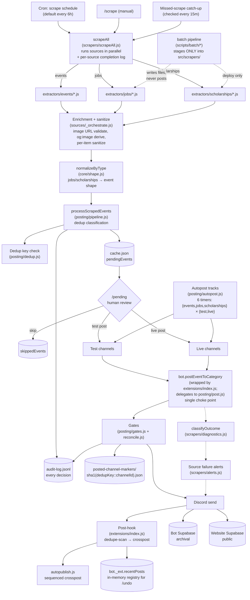
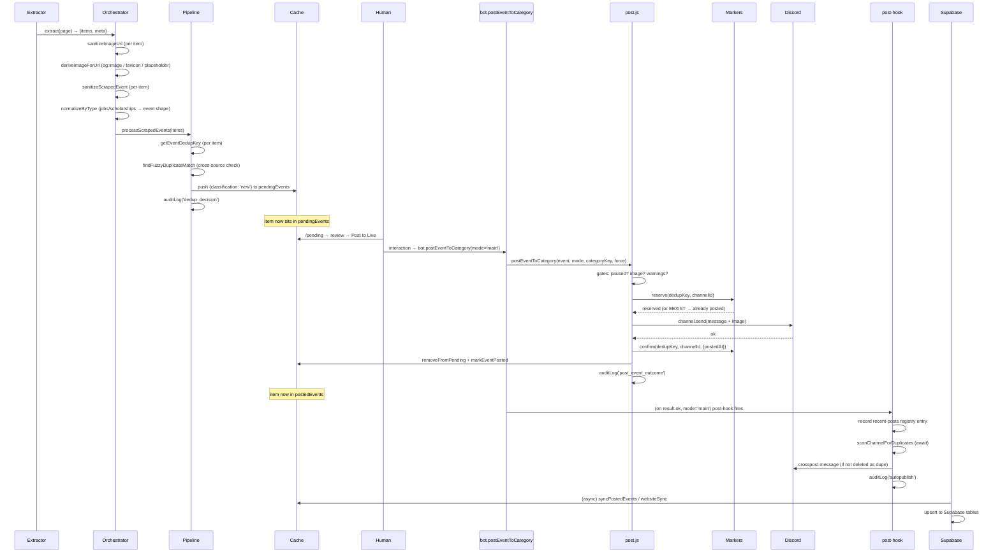
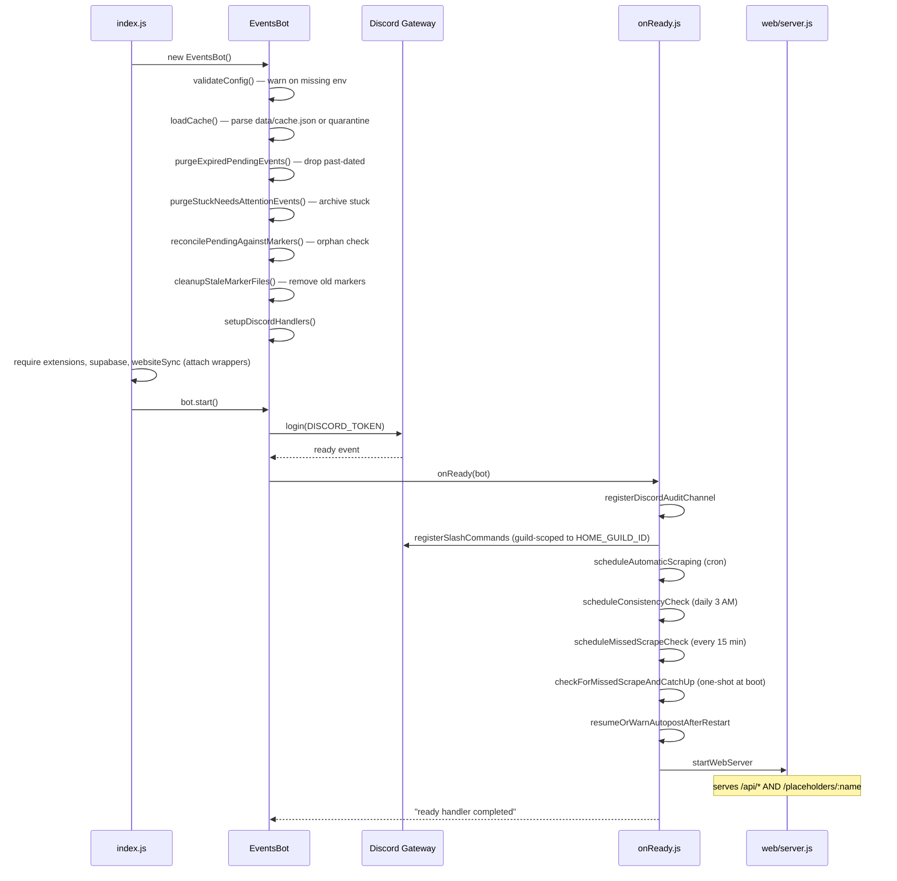

# Architecture

How the pieces fit together and why. Read this before touching code — the module boundaries below are load-bearing, not stylistic.

**Contents**
- [System overview](#system-overview)
- [Lifecycle of one item](#lifecycle-of-one-item)
- [Batch pipeline entry path](#batch-pipeline-entry-path)
- [Startup sequence](#startup-sequence)
- [Module boundaries](#module-boundaries)
- [Chokepoints](#chokepoints)
- [Data flow between modules](#data-flow-between-modules)

---

## System overview



Four properties the diagram is designed to make obvious:

**1. There is exactly one entry path into the cache.** `scrapeAll` produces items → `processScrapedEvents` classifies each as new/pending/posted/skipped/expired → pushes new items to `cache.pendingEvents`. No scraper, no command handler, no dashboard endpoint, no batch command can push into `pendingEvents` directly. This is why dedup is trustworthy — every item goes through the same classification gate.

**2. There is exactly one entry path out of the cache.** `bot.postEventToCategory` is the only function callers use to send items to Discord. It delegates to `posting/post.js`'s `postEventToCategory`, which is the actual implementation — but every caller (the `/pending` "Post to Live" button, the autopost tick, the dashboard `/api/send-event` endpoint) routes through the bot-instance wrapper, not the raw export. The wrapper is what fires the post-hook (dedupe-scan-then-crosspost for autopublish, recent-posts registry for `/undo`). This is why duplicate prevention is trustworthy — every send goes through the same marker-reserve gate — and why the post-hook reliably fires for every live post regardless of entry path.

**3. Everything is audited at the same choke point.** `auditLog()` is called from ~40 places but it's one function, one file, one local file, one optional Discord mirror. A Discord outage never loses a decision record. The file rotates predictably. There's no log-level filtering to hide things at warn vs info; the `level` field is metadata, and every entry is written.

**4. The batch pipeline is a parallel entry path that never touches the four chokepoints at runtime.** It writes extractor source files to `src/scrapers/` at deploy time — that's the only point of contact. It never calls `bot.postEventToCategory`, never touches `cache.json`, never reserves a marker, never writes to the audit log for a runtime decision. It's a **source code generator**, not a runtime participant. The bot only knows about its output after a process restart, and even then treats the generated extractors identically to the hand-written ones. See [Batch pipeline entry path](#batch-pipeline-entry-path) below for why this separation matters.

---

## Lifecycle of one item

The same item — event, job, or scholarship — passes through eleven stages. Every stage has a single owner file, and any bug in that stage is traceable to exactly one module.



The stages, with the owner of each:

| # | Stage | Owner | What it does |
|---|---|---|---|
| 1 | Extract | `src/scrapers/extractors/<type>/<name>.js` | Opens the source site through Puppeteer (or uses `fetch()` for `browserless` extractors), returns `{items, meta}` |
| 2 | Sanitize fields | `src/scrapers/sanitize.js` | Catches mislabeled scrape fields ("🎵Music" in the date slot) and flags them; sanitizes image URLs |
| 3 | Enrich images | `src/scrapers/ogImage.js` + `sources/_orchestrate.js` | For jobs missing an image, derive a per-site image from `<meta og:image>` (cached 30 days per domain), fall back to a generated placeholder PNG served from the bot's own Express server |
| 4 | Shape | `src/core/shape.js` | Remaps jobs and scholarships onto event field names — after this, downstream code doesn't know item type |
| 5 | Dedup | `src/posting/dedup.js` | Computes canonical key, compares to `postedEventKeys` / `pendingEvents` / `skippedEvents` / `expiredEvents`, plus fuzzy-match against posted |
| 6 | Queue | `src/posting/pipeline.js` | Pushes surviving items to `pendingEvents` with `firstSeenAt` |
| 7 | Review | `src/discord/handleButton.js` + `handleCategorySelect.js` + `handleConfirmPost.js` | Human opens `/pending`, picks a category, confirms the post |
| 8 | Post | `src/posting/post.js` | Runs every gate, reserves the marker, sends, confirms the marker |
| 9 | Transition | `src/core/cache.js` | `removeFromPending` + `markEventPosted` (live) or `testPostedAt` (test) |
| 10 | Post-hook | `src/discord/extensions/index.js` | Records recent-post reference; sequences dedupe-scan then crosspost (if autopublish enabled); logs outcome |
| 11 | Sync | `src/integrations/supabase.js` + `websiteSync/engine.js` | Async upsert to two independent Supabase projects. The archival project has one `events` table (jobs ride along via a `type` column) plus a `scholarships` table; the website project has three tables — `events`, `jobs`, `scholarships` — each filtered through its own gates. |

Every stage above can fail independently. A failure at stage 2 flags the item but doesn't block. A failure at stage 3 leaves the image null — the live-post gate rejects it, but the item still reaches `pendingEvents`, so a human can fix the image with Customize. A failure at stage 8 releases the marker so the next attempt can retry. A failure at stage 10 (post-hook) is logged but never undoes the post — the message is already out, the marker is already confirmed, and reversing either would risk a duplicate on the next tick. A failure at stage 11 logs but doesn't touch stages 8-10. This is by design: the pipeline is not transactionally atomic across stages; each stage has its own recovery boundary, and a recovery failure is loudly logged rather than silently swallowed.

The audit log is written at every stage. Every decision point — sanitize pass, dedup classification, category determination, each gate result, marker reserve/confirm/release, post outcome, crosspost result, sync batch — has its own audit category. If you're tracing "why did this item end up here," the audit log tells the full story from extraction to delivery.

---

## Batch pipeline entry path

The batch pipeline (`scripts/batch/*`, documented in [`batch.md`](batch.md)) is a source code generator. Its entire job is to produce files under `src/scrapers/extractors/jobs/` and `src/scrapers/sources/jobs/`. It does not participate in the runtime item lifecycle at all.

This separation is deliberate. If the batch pipeline could post, cache, or reserve markers, then a batch run would need to coordinate with the running bot's cache mutex, the marker system's atomicity guarantees, and the audit log's ordering. All three are hard enough inside the runtime; making an external CLI participate would break every assumption the current design relies on.

**What the batch pipeline does:**

1. Fetches every URL in its `urls.txt` through its own Puppeteer instances (or plain `fetch()` for ATS detection)
2. Classifies each site's shape into one of the template families or the wizard fallback path
3. Renders deterministic templates or writes LLM prompts
4. Runs generated extractors against the live site — **staged into `src/scrapers/`, run, then unstaged**
5. Copies verified-passing extractors into `src/scrapers/` at the deploy step
6. Prints the exact `git add` / `git commit` commands for the human step

**What the batch pipeline does not do:**

- **Does not post to Discord.** No `bot.postEventToCategory`, no `channel.send()`, no marker reserves. The Discord client is never even logged in during a batch run.
- **Does not touch `cache.json`.** The batch reads nothing from `data/cache.json` and writes nothing to it. All batch state lives under `data/batch/<run-id>/`.
- **Does not mutate `data/posted-channel-markers/`.** The batch's own verify step stages/unstages extractor source files, but never touches the marker directory.
- **Does not write to `data/audit-log.jsonl`.** Every batch decision is audited, but to `data/batch/<run-id>/audit.jsonl` — a separate file with a separate schema (`phase`, `event`, `decision`) tuned for pipeline debugging rather than item debugging.
- **Does not push to Supabase.** Archival and website sync are runtime concerns; the batch has no reason to know they exist.

The only side effects visible to the running bot are:

1. **Files appear in `src/scrapers/extractors/jobs/` and `src/scrapers/sources/jobs/`** — the deploy step. Invisible until restart, since `require()` caches modules at boot.
2. **Files appear in `data/og-image-cache.json`** — the batch verify runs the same enrichment logic as the runtime scrape, so the og:image cache is warmed during batch runs. This is an optimization, not a requirement; the runtime scrape would warm it on first run anyway.

**Why this is the right shape:** the four chokepoints (`bot.postEventToCategory`, `getEventDedupKey`, `auditLog`, `markers.reserve`) exist to guarantee item-level invariants — dedup identity, atomic post-or-check, exhaustive audit trail. A batch pipeline that never touches items can't violate those invariants. A future contributor adding a "post each generated extractor's output to a test channel for spot-checking" feature would need to route through `bot.postEventToCategory` like every other caller, at which point the batch becomes a runtime participant and inherits all the concerns above. The current design keeps it out.

**Restart discipline.** After `batch deploy`, the bot must be restarted for the new sources to take effect. This is not a limitation — it's the correct behavior. A running process discovering new source files mid-scrape would break the assumption that `scrapeAll`'s source list is stable for the duration of a run. Restart is the explicit boundary between "batch produced sources" and "bot uses sources."

---

## Startup sequence

What happens between `node src/index.js` and "ready handler completed." Every step is idempotent — running it twice does nothing the second time.



Three things worth calling out:

**Cache fixes happen before login.** The four startup sweeps (`purgeExpired`, `purgeStuck`, `reconcile`, `cleanupStaleMarkers`) run synchronously in the constructor, before `client.login()`. This means the cache is consistent before any interaction can arrive. If a bot crashes and restarts, the fixups complete before the bot is reachable.

**The ready handler is fault-tolerant by step.** Each step in `onReady` is wrapped in its own try/catch. A failed slash-command registration doesn't stop the scraper from being scheduled. A failed scrape schedule doesn't stop the web server from coming up. The bot should come online degraded rather than not come online at all.

**The Express server serves two roles.** `/api/*` is the dashboard backend. `/placeholders/:name.png` is the image enrichment fallback — the bot fetches its own placeholder PNGs via `127.0.0.1:${WEB_PORT}/placeholders/<name>.png` during job item enrichment. Both routes register at the same time, before the ready handler completes. A batch-deployed source whose site has no `og:image` relies on this route existing.

**Three separate `ready` listeners register commands.** `commands/registerSlashCommands.js` registers the base commands with `Routes.applicationGuildCommands` (guild-scoped) and then wipes any globally-registered commands with `Routes.applicationCommands([])` — that second call is the one-time cleanup for installs that predate guild-scoping. `extensions/index.js`, `integrations/supabase.js`, and `integrations/websiteSync/index.js` each register their own commands via `Routes.applicationGuildCommands` at `ready` time. All four use the guild-scoped route; none use the global route. If any of them ever emits a boot log without `to guild <ID> only`, that's a regression — those commands would appear in every guild the bot is in. The admin gate still blocks execution elsewhere, but the commands shouldn't be visible at all.

---

## Module boundaries

The `src/` tree has seven top-level concerns. Each one has a rule about what it can touch.

```
src/
├── config/      static data — read-only, no imports from other layers
├── core/        pure primitives — no bot state, no network, no discord
├── scrapers/    source-specific extraction — the only layer that talks to puppeteer
├── posting/     state transitions — the only layer that mutates cache
├── discord/     user-facing surface — thin handlers, no business logic
├── web/         HTTP surface — thin handlers, no business logic
└── integrations/ async sinks — outbound to Supabase
```

### `config/` — static only

`env.js`, `constants.js`, `emojis.js`, `roles.js`. These modules read from `process.env` (in `env.js`) or hardcode values. They import nothing from other `src/` layers. Every other layer imports *from* them.

The rule: **if a value can change, it lives here.** Thresholds, timezone, emoji IDs, ping role IDs, channel IDs. If you find a magic number in another file, it belongs in `constants.js`.

`roles.js` also exports `normalizeRoleId()`, which accepts either a raw snowflake (`123456789012345678`) or a mention-wrapped value (`<@&123456789012345678>`) and returns the raw snowflake (or `null` for anything that isn't a valid 17-19 digit snowflake after unwrapping). Every place in the codebase that builds a role mention — `getPingMention()` in `roles.js`, `deliverAlert()` in `scrapers/alerts.js` — routes through it. `.env` role-ID values are documented to accept either form; the normalizer is what makes that forgiving without allowing a wrapped value to end up double-wrapped in the final `<@&<@&123...>>` output.

### `core/` — pure functions, no bot instance

`auditLogger.js`, `mutex.js`, `dateUtils.js`, `cronParser.js`, `normalize.js`, `sanitize.js`, `deadlineText.js`, `markers.js`, `shape.js`, `formatting.js`, `cache.js`, `validation.js`, `ui.js`, `messages.js`.

Almost everything in `core/` is a pure function — takes arguments, returns values, no side effects beyond what's declared. The exceptions (`auditLogger`, `markers`, `cache`) touch the filesystem, but they take `(bot, ...)` or `(key, channelId)` as explicit parameters rather than reaching into a global.

The rule: **no `require('../bot')`.** If a `core/` module needs bot state, the caller passes it in explicitly. This keeps `core/` unit-testable without a live bot.

**`core/ui.js`** is the shared terminal UI primitives (banners, tags, `resultRow`, `summary`, `divider`, `progressBar`). It was originally under `scripts/batch/lib/ui.js` and got promoted to `core/` when `scrapeAll`, `post.js`, `supabase.js`, and `websiteSync/engine.js` needed the same visual language as the batch phases. `scripts/batch/lib/ui.js` is a shim that re-exports from `core/ui.js` for backward compatibility with the batch pipeline's imports. Every phase that prints human-readable status (scrape, post outcomes, sync batches, batch verify) uses the same primitives, so the terminal output reads as one coherent voice.

**`core/messages.js`** is the human-readable message catalogue. Every reason code that can appear in user-facing output (`dom_drift_listing`, `low_precision`, `empty-wizard`, `no_image`, `already_posted`, etc.) has a `{ label, explanation, fix, severity }` entry. Consumers render via `messages.label(code)` for one-line contexts, `messages.render(code, opts)` for full multi-line contexts with explanation + fix. Adding a new reason code without adding a corresponding message entry means users see the raw code — a debug fallback, not a shipping state. `scripts/batch/lib/messages.js` is a shim that re-exports from `core/messages.js`.

### `scrapers/` — the puppeteer boundary

`browser.js`, `page.js`, `retry.js`, `text.js`, `progress.js`, `sanitize.js`, `selectors.js`, `diagnostics.js`, `alerts.js`, `ogImage.js`, `jobs.js`, `scholarships.js`, `registry.js`, `scrapeAll.js`, `sources/`, `extractors/`.

The rule: **no `require('../posting/...')`, no `require('../bot')`.** Scrapers produce items and return them. They don't know about Discord, don't know about cache, don't know about posting. `scrapeAll` returns `{items, meta, errors}` and the pipeline takes it from there.

The sub-rule about `sources/` vs `extractors/`: `sources/<type>/<name>.js` is a five-line wrapper. `extractors/<type>/<name>.js` contains the actual DOM work. The wrapper calls `runSource(name, type, ctx)` which loads the extractor, calls it, applies common sanitization, enriches missing images, and returns `{items, meta}`. This means a forker can replace one file (the extractor) to change how a source is scraped, without touching the wrapper or the orchestration.

**`ogImage.js`** is the image enrichment helper. It exposes two functions:

- `deriveImageForUrl(url)` — fetches `<meta og:image>` from the site's homepage (falling back to `<link rel="icon">`), caches the result per-hostname for 30 days in `data/og-image-cache.json`, and deduplicates concurrent in-flight fetches for the same hostname (68 items from one site → 1 HTTP fetch).
- `derivePlaceholderForSource(name)` — returns a URL to a generated placeholder PNG if one exists in `data/placeholder-images/`, `null` otherwise. Placeholders are generated by `scripts/generate-placeholders.js` (Puppeteer one-shot: black background, white company name centered, auto-shrinking font for long names).

Both are called from `sources/_orchestrate.js` after extraction, not from individual extractors. Jobs missing an image after extraction get one derived — that's why every job extractor's `companyLogoUrl` is set correctly without each extractor needing to handle image logic itself.

`extractors/index.js` loads real extractor files and caches the resolution in-process. The orchestrator calls `extractor.extract(page, ctx)` — either with a live Puppeteer page (default) or with `null` (for extractors that declare `browserless: true` and use `fetch()` directly).

### `posting/` — the only cache mutator

`dedup.js`, `category.js`, `gates.js`, `reconcile.js`, `post.js`, `autopost.js`, `schedule.js`, `pipeline.js`, `consistency.js`.

The rule: **`posting/` is the only layer that writes to `bot.cache`** (with the sole exception of `core/cache.js` helper functions it calls into). Every state transition — `pending → posted`, `pending → skipped`, `pending → expired`, marker reserve/confirm/release — happens in `posting/`. Discord handlers call `posting/` functions. Web endpoints call `posting/` functions. No other layer mutates cache state.

This is what makes concurrency safe. `posting/post.js` acquires a per-(item,channel) reservation before sending. `posting/pipeline.js` runs under `bot.cacheMutex`. `posting/autopost.js` runs its ticks under the same mutex. Nothing else in the codebase can interleave with them.

**Sub-rule: `posting/autopost.js` calls `bot.postEventToCategory`, not `post.postEventToCategory`.** This is the load-bearing distinction that everything else in the codebase depends on being consistent. The raw `post.postEventToCategory` implementation is the actual send logic — gates, marker, channel.send — but the bot-instance wrapper (installed by `extensions/index.js` in `attachPostHooks`) is what fires the post-hook sequence that records recent-posts and does the autopublish dedupe-then-crosspost. Any code path that skips the wrapper produces a post that doesn't appear in `/undo`'s registry and doesn't get crossposted, silently. This was actually a shipped bug once (autopost called the raw export, so autopublish never fired for autoposted items) and it's exactly the class of bug that "follow the choke point" prevents.

### `discord/` and `web/` — thin handlers

`bot.js` handlers, command files, extension files, and `web/server.js` are *transport adapters*. They receive user input or HTTP requests, call one `posting/` or `core/` function, and return a response. No business logic, no state mutation of their own.

The rule: **handlers don't loop, don't dedupe, don't post directly, don't write cache.** If a handler needs to do more than validate-and-delegate, that logic belongs in `posting/` or `core/` and the handler becomes a three-line adapter.

`discord/scrapeAndNotify.js` is a slightly larger adapter — it wraps `scrapeAll` with progress-bar rendering and calls `pipeline.processScrapedEvents` under the cache mutex. It's the seam between the scraper layer and the pipeline layer; it exists because the progress bar needs to know "how many sources are in flight" and the pipeline needs to know "did this scrape produce anything," and those two concerns meet here and nowhere else.

### `integrations/` — outbound async

`supabase.js`, `websiteSync/`. These modules attach to the bot, install hooks (they monkey-patch `bot.postEventToCategory` and `bot.markEventPosted`), and reach out to Supabase asynchronously. They never write to cache — they only read from it and push to external services.

The rule: **integrations fail loudly, never crash the bot.** Every Supabase call is wrapped in try/catch. Every batch failure is logged with the failed batch and retried on the next tick. The bot functions exactly as if there were no Supabase configured — the integrations are pure upside.

Integrations wrap `bot.markEventPosted` (not `core/cache.js::markEventPosted` directly) so their cache-mutation observer sees every mark regardless of which layer invoked it. Same reasoning as the post hook: wrap the bot-instance method, so all callers benefit, not just those that happen to import the raw function.

Both integration files print styled status lines via `core/ui.js` (banner, `resultRow`, summary) so the operator sees sync outcomes in the same visual language as scrapes and posts.

### `scripts/batch/` — the source-code generator (outside `src/`)

Not an `src/` layer, but worth documenting here because its relationship to `src/` is deliberately constrained. See [Batch pipeline entry path](#batch-pipeline-entry-path) above for the full reasoning.

The rule: **`scripts/batch/` writes files into `src/scrapers/` at deploy time and nothing else.** It does not import from `src/posting/`, `src/discord/`, `src/integrations/`, or `src/bot.js`. It imports `src/scrapers/` (to run extractors during verify) and `src/core/` (for `ui`, `messages`, `sanitize` — used by the generated extractors at runtime, not by the batch pipeline itself).

The `scripts/batch/lib/ui.js` and `scripts/batch/lib/messages.js` files are shims that re-export from `core/ui.js` and `core/messages.js` — the move to `core/` happened so that `src/posting/post.js`, `src/scrapers/scrapeAll.js`, `src/integrations/supabase.js`, and `src/integrations/websiteSync/engine.js` could all use the same styles without importing from `scripts/batch/` (which would be a layer violation). The shim exists so the batch files that already import `./lib/ui` continue working unchanged.

---

## Chokepoints

Four functions are the entire safety guarantee of the system. If you change anything, these are the four you cannot bypass. The batch pipeline respects all four by never invoking them — it only writes files that will be loaded by the runtime later.

### `bot.postEventToCategory(event, mode, categoryKey, force)` — wraps `src/posting/post.js`

Every Discord post goes through this. The bot-instance wrapper is thin (it awaits the underlying `post.postEventToCategory` and fires the post-hook on success), but it's the wrapper that matters for two reasons that keep growing the more extensions get added:

1. **Post-hook side effects.** After a successful live post, the wrapper records a recent-posts entry (used by `/undo` and `/edit-live` to locate the message) and fires the sequenced dedupe-then-crosspost flow for autopublish. Neither of these fires if you call `post.postEventToCategory` directly.

2. **A single call-site rule.** Every caller — the `/pending` confirm button, the autopost tick, the dashboard `/api/send-event` endpoint, any future feature — routes through `bot.postEventToCategory`. Because there's exactly one wrapper point, there's exactly one place to add new post-success behavior (metrics, alerts, webhooks) and it automatically applies to every entry path. If callers used the raw export, each new behavior would need to be re-wired at every call site and one of them would eventually be missed.

The underlying `post.postEventToCategory` runs every gate (paused category, image validity, data-quality warnings, dedup check), reserves the marker, fetches the image, sends the message, confirms the marker, and returns a structured outcome. It also emits one human-readable status line per attempt (via `core/ui.js` + `core/messages.js`) so the operator sees every post outcome in plain English — success, `no_image`, `already_posted`, etc. — without needing to grep the audit log.

**Rule, in one line:** `bot.postEventToCategory` from anywhere outside `bot.js`; `post.postEventToCategory` only from inside `bot.js`'s thin delegate.

**How the batch pipeline respects it:** it doesn't call it. The batch never posts. It produces extractors that, at runtime, will eventually feed items into this function through the normal pipeline — but the batch itself is not a caller.

### `getEventDedupKey(event)` — `src/posting/dedup.js`

Every dedup decision (has this been posted? is this pending? is this a fuzzy match?) keys off this function. Two items with the same canonical key are treated as identical.

If you add a field to items and change how their identity is computed — say, dropping the date from the key — the whole `postedEventKeys` / `pendingEvents` dedup breaks silently. Existing markers won't match new keys. Duplicates start appearing.

The key has two paths: canonical-date-first when a date parses, URL-based fallback when it doesn't. Both must stay deterministic — the same item scraped twice must produce the same key. Any non-determinism in the fallback component (a timestamp, a random substring) breaks the entire system on the next scrape. The fallback hashing helper (`shortHash` in `core/normalize.js`) takes a deterministic string of `source|description` — no clock, no randomness, by design.

**How the batch pipeline respects it:** it uses a separate dedup mechanism (`scripts/batch/lib/naming.js` for source names, snapshot-based collision resolution). It never calls `getEventDedupKey` — no item identity is computed in the batch, because there are no items.

### `auditLog(category, message, data, level)` — `src/core/auditLogger.js`

Every decision the bot makes writes through this function. It's a plain module-level singleton, not a class — scrapers can require it without a bot instance. It writes to the local file first (always, unconditionally), then best-effort mirrors to Discord.

If you add a new decision point that doesn't call `auditLog`, you've created a decision that leaves no forensic trace. The next time something behaves unexpectedly, there'll be no record of why.

The audit file rotates at 5000 lines or 5 MB, whichever comes first, and keeps the most recent 5000 entries. Rotation is by line-drop, not by archive — the local file is a rolling window of recent activity, not a permanent record. Any decision that needs to survive beyond 5000 entries needs to be written somewhere else (the `cache.json` state itself, usually, or an external log sink).

**How the batch pipeline respects it:** it has a separate audit surface — `scripts/batch/lib/audit.js`, writing to `data/batch/<run-id>/audit.jsonl`. Same *concept* (append-only JSONL, one entry per decision) but a different file, a different schema (`phase`, `event`, `decision` instead of `category`, `message`, `data`, `level`), and a different lifecycle (deleted with the run directory, not rotated). The separation is deliberate — an operator debugging a batch run wants to read one small file, not search the bot's 8000-line log for a needle.

### `markers.reserve(dedupKey, channelId, opts)` — `src/core/markers.js`

Every channel post reserves a marker file before sending. `reserve()` uses `fs.writeFileSync(..., { flag: 'wx' })`, which atomically fails if the file already exists. That's the entire duplicate-prevention guarantee.

If you send before reserving, or if you check-then-send instead of reserve-then-send, two concurrent callers can both pass the check and both send. The marker file is what makes the "post or check" decision atomic.

A marker goes through three states: `reserved` (heartbeat-active), `confirmed` (`postedAt` set), and `gone` (deleted after a failed send or via `/undo`). The `STALE_RESERVATION_MS` threshold (90s, from last heartbeat, not original reserve time) is what distinguishes "genuinely abandoned" from "slow but alive" — a slow image download keeps refreshing `heartbeatAt`, so it never reads as stale mid-send. Stale reservations go through `posting/reconcile.js`'s Discord check: if the message is there, the marker upgrades to confirmed; if not, it clears; if the check itself fails (rate limit, permissions), the marker stays reserved (fail-closed). The reconciliation is what makes crashes survivable without creating duplicates.

**How the batch pipeline respects it:** it doesn't touch it. `batch verify` stages extractor source files into `src/scrapers/`, runs them, then unstages — but the staging is source files, not markers. `data/posted-channel-markers/` is never read or written by the batch pipeline.

---

## Data flow between modules

One sentence per boundary, useful when tracing a bug:

- **`config/env.js` → everything** — every module reads from the same centralized env config.
- **`config/roles.js` → `core/formatting.js`, `scrapers/alerts.js`** — role mention strings for live posts and source alerts are built via `getPingMention()` / `normalizeRoleId()`, which handles both raw snowflake and `<@&...>` inputs.
- **`core/ui.js` → every phase that prints status** — `scrapeAll`, `post.js`, `supabase.js`, `websiteSync/engine.js`, and every `scripts/batch/*` phase render through the same `banner` / `resultRow` / `summary` primitives.
- **`core/messages.js` → every phase that surfaces a reason code** — `post.js`, `scrapeAll`, `scripts/batch/report.js`, `scripts/batch/verify.js` render the human-readable label + explanation + fix instead of the raw code.
- **`scrapers/registry.js` → `scrapers/scrapeAll.js`** — registry exposes `getAllSources()`; scrapeAll calls each `plugin.scrape(ctx)`.
- **`scrapers/extractors/index.js` → `scrapers/sources/_orchestrate.js`** — loader resolves extractor by name; orchestrator calls `extractor.extract(page, ctx)`.
- **`scrapers/sources/_orchestrate.js` → `scrapers/ogImage.js`** — after extraction, `runSource` calls `deriveImageForUrl` for job items missing an image, then `derivePlaceholderForSource` if derivation returned null.
- **`scrapers/scrapeAll.js` → `scrapers/diagnostics.js`** — each source's `{items, meta}` feeds `classifyOutcome()`.
- **`scrapers/scrapeAll.js` → `core/shape.js`** — job and scholarship items are normalized to event shape before returning.
- **`scrapers/diagnostics.js` → `scrapers/alerts.js`** — non-ok verdicts trigger `recordOutcome(bot, source, type, verdict)`.
- **`discord/scrapeAndNotify.js` → `scrapers/scrapeAll.js`** — scrape is invoked through the progress-aware wrapper.
- **`discord/scrapeAndNotify.js` → `posting/pipeline.js`** — scraped items feed `_processScrapedEventsLocked`, which calls `processScrapedEvents`.
- **`posting/pipeline.js` → `posting/dedup.js`** — every incoming item is classified via `getEventDedupKey` + `findFuzzyDuplicateMatch`.
- **`discord/handleConfirmPost.js` → `bot.postEventToCategory`** — manual confirmation routes through the same wrapper the autopost tick uses.
- **`posting/autopost.js` → `bot.postEventToCategory`** — the tick loop uses the wrapped version so post-hook side effects (autopublish, recent-posts) fire identically to the manual path.
- **`bot.postEventToCategory` → `posting/post.js`** — thin delegate; the actual gate/reserve/send/confirm chain lives in `post.js`.
- **`posting/post.js` → `core/markers.js`** — the reserve/confirm/release cycle is the dedup guarantee.
- **`posting/post.js` → `core/formatting.js`** — message rendering is a pure function call, not a state-dependent chain.
- **`posting/post.js` → `core/sanitize.js`** — re-sanitizes before every send so `/pending` Customize edits are reflected.
- **`posting/post.js` → `core/ui.js` + `core/messages.js`** — one human-readable status line per post attempt, tagged pass/fail/warn/skip and labelled with the plain-English reason.
- **`posting/autopost.js` → `posting/gates.js`** — pre-post filters (too-soon, has-image, data-quality) use the same gate functions.
- **`posting/reconcile.js` → `core/markers.js`** — stale reservations are verified against Discord before being cleared.
- **`discord/extensions/index.js` → `bot.postEventToCategory`** — the post-hook wraps the bot-instance method (never the raw export) so every caller benefits.
- **`discord/extensions/index.js` → `bot._processScrapedEventsLocked`** — the blacklist filter wraps the pipeline method so every scrape entry path benefits.
- **`integrations/supabase.js` → `bot.markEventPosted`** — the sync scheduler hooks the bot-instance method so it fires for every mark regardless of caller layer.
- **`integrations/supabase.js` → `core/auditLogger.js`** — every sync run writes an audit entry.
- **`integrations/websiteSync/engine.js` → `posting/dedup.js`** — URL-based dedup for jobs uses a variant of the same identity computation, anchored on `url` rather than title+date because the source rewrites deadlines on every scrape.
- **`web/server.js` → `data/placeholder-images/`** — the `/placeholders/:name.png` route serves generated placeholder PNGs for image-less job sites. `web/server.js` is the only layer that reads from this directory at request time.
- **`scripts/batch/*` → `src/scrapers/`** — the batch's deploy step writes extractor source files. That's the entire cross-layer boundary between the batch pipeline and the running bot.
- **`posting/consistency.js` → `core/markers.js`** — the daily sweep reads every marker file and diffs against `postedEvents`.

When a bug appears in one of these boundaries, the fix belongs on the side that owns the contract. A malformed item arriving at `processScrapedEvents` is a scraper bug. A malformed item arriving at `channel.send` is a `posting/post.js` bug. A malformed item arriving at Discord and being seen by a human is a `discord/sendPendingEventsMessage.js` bug. Knowing which of these three stages owns which class of bug is what makes debugging tractable in a system this size.

The single hardest class of bug to trace is "the wrapper didn't fire." If a live post went out but there's no `autopublish` audit entry, or if a live post went out but `/undo` can't find it in `recentPosts`, the first thing to check is whether the code path called `bot.postEventToCategory` or `post.postEventToCategory`. The former fires hooks; the latter doesn't. There's no runtime guard for this — the two functions have the same name and nearly the same signature — so it's caught by review and by tests that assert hook side-effects.