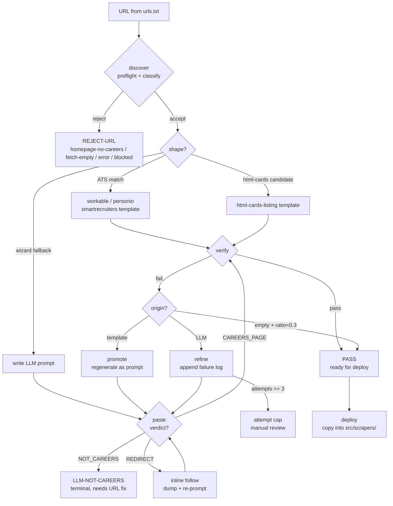
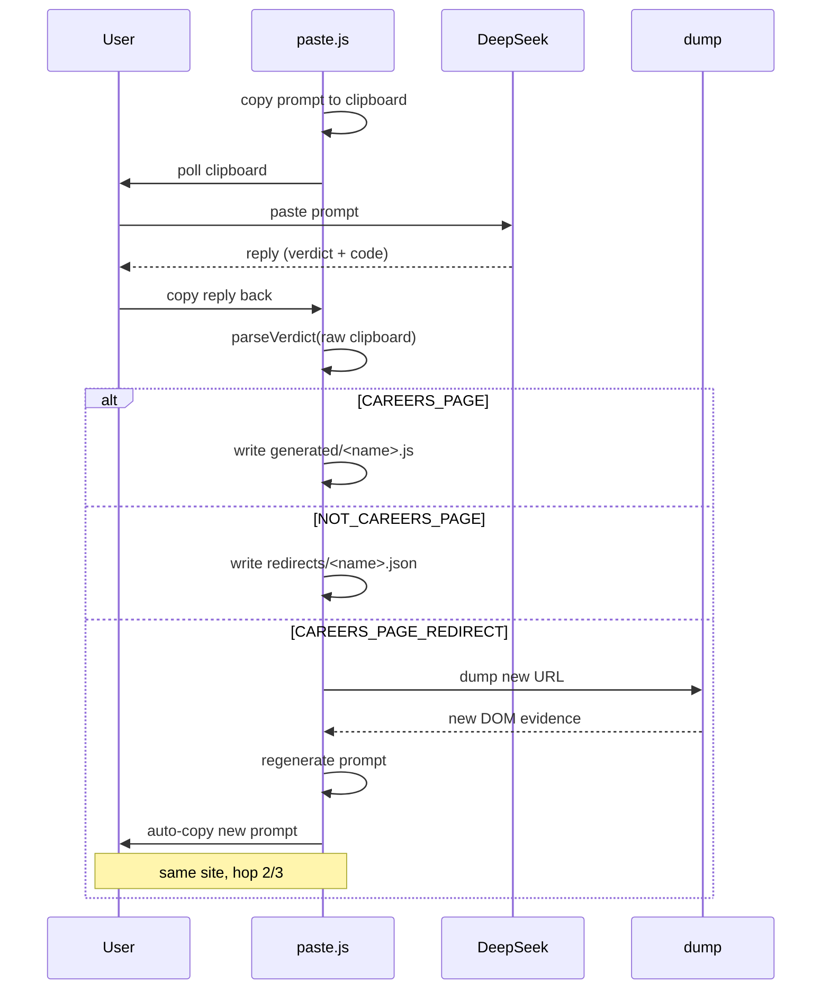

# Batch pipeline

How to onboard dozens of sources at once — dump, classify, generate, verify, refine, deploy — with one interactive paste step. Read [`scrapers.md`](scrapers.md) first for the extractor contract, and [`architecture.md`](architecture.md#batch-pipeline-entry-path) for why the batch pipeline is a source-code generator rather than a runtime participant.

**Contents**
- [Overview](#overview)
- [What a real batch looks like](#what-a-real-batch-looks-like)
- [Features](#features)
- [Two paths: single source vs batch](#two-paths-single-source-vs-batch)
- [The one-command path](#the-one-command-path)
- [The phase-by-phase path](#the-phase-by-phase-path)
- [How a URL flows through the pipeline](#how-a-url-flows-through-the-pipeline)
- [Templates vs prompts](#templates-vs-prompts)
- [The two-way loop](#the-two-way-loop)
- [Verify, refine, promote](#verify-refine-promote)
- [Deploy](#deploy)
- [Run directory layout](#run-directory-layout)
- [Where a specific file lives](#where-a-specific-file-lives)
- [Failure modes and what to do](#failure-modes-and-what-to-do)
- [Flags and environment](#flags-and-environment)
- [Limitations](#limitations)
- [Quick reference](#quick-reference)

---

## Overview

The manual scraper pattern in [`scrapers.md`](scrapers.md) covers one source at a time: write the wrapper, write the extractor, verify, commit. That works for a three-source addition. It does not scale to a batch where each source needs a dump, a classify, a prompt, a paste, and a verify — that's four minutes per source before anything has been tested against the live DOM, and the site shapes are only *roughly* similar across companies.

The batch pipeline exists to compress that. It lives entirely under `scripts/batch/`, reads and writes only `data/batch/<run-id>/`, and stages extractors into `src/scrapers/` only at the deploy step. Between those two boundaries it:

1. **Discovers.** Fetches every URL in parallel, runs a preflight classification to reject homepages / dead links / captchas, follows career-page hints when the entry URL isn't a listing, detects ATS vendors (Workable, Personio, SmartRecruiters) from the raw HTML.
2. **Generates.** Renders a deterministic template for sites whose DOM shape matches a known extractor pattern. Writes a self-contained LLM prompt for everything else.
3. **Pastes.** Interactive clipboard loop: prompt → DeepSeek → copy reply → validate → advance. When the LLM's verdict is `CAREERS_PAGE_REDIRECT`, follows it inline and re-prompts without leaving the loop.
4. **Verifies.** Stages every generated extractor into `src/scrapers/`, runs it against the live site in parallel, unstage on exit — pass or fail, atomic. Empty-vs-drift discrimination runs before classification so "no jobs today" isn't counted as breakage.
5. **Refines.** For every LLM-origin failure, appends the failure log to the prompt and re-prompts the LLM. Bounded at 3 attempts per site.
6. **Deploys.** Copies verified-passing extractors into `src/scrapers/` with the standard wrapper. Syntax-checks every file before writing. Refuses to overwrite.

Every phase is idempotent. Every phase writes per-site files into the run directory, so an interrupt at any point can be resumed by re-running the same command.

**The batch pipeline never touches the running bot.** It doesn't log in to Discord, doesn't read or write `data/cache.json`, doesn't reserve markers, doesn't write to `data/audit-log.jsonl`. All batch state is under `data/batch/<run-id>/` with its own audit surface. The only runtime-visible side effect is that new extractor files appear on disk at deploy, which the running bot won't see until restart. See [`architecture.md#batch-pipeline-entry-path`](architecture.md#batch-pipeline-entry-path) for the full reasoning.

### What to expect at each scale

| Sources | Machine time | Interactive time | Committed extractors (typical) |
|---|---|---|---|
| 3 sources | ~5 min | ~5 min | 2–3 |
| 30 sources | ~15 min | ~25 min | 18–25 |
| 76 sources | ~30 min | ~1–1.5 h | 50–60 |

Interactive time is dominated by the paste round-trip. Machine time is discover + generate + verify + refine. The ratio gets worse as batch size grows because refine cycles multiply.

---

## What a real batch looks like

A recent 76-URL batch (companies-76) hit these outcomes:

| Bucket | Count | Meaning |
|---|---|---|
| PASS | 58 | Extractor verified, deployed |
| REJECT-URL | 8 | Discover rejected (homepage-no-careers, fetch-empty, error) |
| LLM-NOT-CAREERS | 9 | LLM read the page and said "no job listings" |
| FAIL-TIMEOUT | 1 | Ran past 60s timeout even after 3 refine attempts |

Breakdown of the 58 PASS:

- 50 with `items > 0` — real working extractors with real jobs
- 8 with `items == 0` — passed as "No jobs right now" via empty-vs-drift discrimination (deployed anyway; they'll produce items when the site has openings)

Breakdown of the origin split:

- 13 templated (Workable / Personio / SmartRecruiters / html-cards-listing)
- 45 LLM-generated (paste round-trip)

Wall clock: ~2 hours total (15s discover, 4min generate, ~80min paste, ~30min auto loop, 5min deploy+commit).

The 9 LLM-NOT-CAREERS sites in that batch ranged from "agency homepage, no careers section" to "URL resolves to a 404." Those aren't failures — they're the LLM saving the pipeline from writing extractors for pages that don't have jobs. All 9 are surfaced in the report with the LLM's reason, so the operator can fix `urls.txt` and re-run if the site really does have openings elsewhere.

The 8 REJECT-URL sites were caught before any LLM work — either genuinely dead URLs (empty response) or homepages with no careers link. Two full seconds of discover per site was the entire cost.

---

## Features

- **One-command path.** `pulchowk-events batch run urls.txt --run mybatch` runs every phase in sequence with per-phase checkpointing. Phases whose work is already done skip with a one-line reason. Fresh run = full pipeline. Interrupted run = resumes from the last completed step. The only step that stops for human input is paste.

- **Deterministic templates where they apply.** Four templates in `scripts/batch/templates/` cover Workable, Personio, SmartRecruiters, and single-page HTML listings. When the wizard dump matches one of those shapes (card candidates with `hasJobishContent` and `jobTitleRatio >= 0.3` for HTML listings; ATS fingerprints in the raw HTML for the rest), the extractor is rendered from a template. Same input shape always produces the same extractor. No LLM in the loop. No human in the loop.

- **Two-way LLM loop.** Every prompt asks the LLM to declare a verdict before writing code: `CAREERS_PAGE`, `NOT_CAREERS_PAGE`, or `CAREERS_PAGE_REDIRECT -- <url>`. A redirect verdict is followed inline — the batch dumps the target URL, regenerates the prompt, and continues the same site's loop without the user needing to do anything. A not-careers verdict is recorded and the site lands in a terminal bucket, so you can fix the URL later with context instead of guessing.

- **Empty-vs-drift discrimination.** A `dom_drift_listing` failure normally means the extractor couldn't find the page it expected. But "the site has no jobs this week" produces the same zero-item outcome. The batch compares the extractor's output against the discovery-time dump: if the dump showed no plausible job group (max `jobTitleRatio < 0.3`), the extractor returning zero is correct behavior and the site passes as `empty-wizard`. Only if the dump *did* show job content does the extractor's zero become `dom_drift_listing` and fail.

- **Refine retries with evidence.** When a verify fails on an LLM-origin extractor, `batch refine` appends the failure log to the prompt (item count, verdict, stderr tail) and gives the LLM its own failure to work from. Same prompt shape, same quality bar, but now with a concrete error to fix. Bounded at 3 attempts per site so a genuinely broken URL doesn't burn infinite cycles.

- **Identity check on every paste.** Before writing any extractor to disk, the poller verifies the code references the current site — by name, by hostname, or by word in the header comment. A wrong-clipboard copy (user pasted a previous site's reply) is rejected with a clear warning and the poller keeps waiting. This has caught real mistakes in every multi-site batch.

- **Human-readable failure messages.** Every reason code in the batch pipeline — `dom_drift_unknown_shape`, `low_precision`, `empty-wizard`, `no_image`, `already_posted` — maps to a `{ label, explanation, fix }` entry in `src/core/messages.js`. `batch report` and `batch verify` render those entries instead of raw codes. A user reading the failure list sees "Page layout not recognized — When discovery first visited this page, it could not confidently identify a list of job listings. Next step: Run `batch refine --only <site>`." Not `dom_drift_unknown_shape`.

- **Safe deploy.** `batch deploy` refuses to overwrite an existing extractor in `src/scrapers/` unless `--force`. Runs `node --check` on every file before copying. Prints the exact git commands for the human step, but does not run git itself. The pipeline commits nothing on your behalf.

- **Image enrichment, not extraction.** Jobs typically have no per-item image. The orchestrator (`src/scrapers/sources/_orchestrate.js`) derives a per-site image from `<meta og:image>` (cached for 30 days in `data/og-image-cache.json`) or a generated placeholder PNG (`scripts/generate-placeholders.js`) when neither is present. This is uniform across every batch-generated extractor — no extractor needs to handle image extraction itself. See [`scrapers.md#batch-generated-sources`](scrapers.md#batch-generated-sources).

---

## Two paths: single source vs batch

**One source → use the wizard.** `pulchowk-events add <url> --type jobs` walks you through dump → classify → prompt → paste → verify. Three to five minutes. No run directory, no state file. Covered in [`scrapers.md#adding-a-source-guided`](scrapers.md#adding-a-source-guided).

**Three or more sources → use the batch pipeline.** Setup is one file and one command. The batch handles every tedious step (URL resolution, template detection, prompt generation, verification, refinement) and asks you only for the LLM round-trip.

**One to three sources** — either path works. Wizard for exploratory one-offs, batch for anything you're committing to production.

---

## The one-command path

```
pulchowk-events batch run urls.txt --run mybatch
```

That's the whole pipeline. Behind the scenes it runs `init → discover → generate → check → paste → auto → deploy → report`, each phase with its own checkpoint.

Typical fresh-run output:

```
▶ Batch Run
  run mybatch · deploy enabled

  ▸ RUN  init       run dir does not exist
  ▸ RUN  discover   classes.json missing
  ▸ RUN  generate   76 accepted site(s) need templates or prompts
  ▸ RUN  check      always runs (fast)
  ▸ RUN  paste      53 prompt(s) need paste
      [interactive loop — Ctrl+C to abort]
  ▸ RUN  auto       always runs (verify loop)
  ▸ RUN  deploy     58 site(s) to deploy into src/scrapers/
  ▸ RUN  report     always runs (summary)
```

Interrupted mid-paste? Re-run `batch run --run mybatch` — it resumes at paste with the remaining prompts. `SKIP` lines replace `RUN` lines for phases whose work is already complete:

```
  ▸ SKIP init       urls.txt present, no new urls file supplied
  ▸ SKIP discover   classes.json exists
  ▸ SKIP generate   every accepted site has a prompt or extractor
  ▸ RUN  check      always runs (fast)
  ▸ SKIP paste      no prompts waiting paste
  ▸ RUN  auto       always runs (verify loop)
  ▸ SKIP deploy     no new passing extractors to deploy
  ▸ RUN  report     always runs (summary)
```

After `deploy`, the pipeline prints the exact `git add` and `git commit` commands. It does not run git itself; that's your step.

---

## The phase-by-phase path

When something goes wrong or you want finer control, run individual phases:

| Command | What it does |
|---|---|
| `batch init <urls-file> [--run <id>]` | Create the run directory, snapshot `src/scrapers/` state, seed `urls.txt` |
| `batch discover [--run <id>]` | Fetch every URL, classify, follow career links, write `classes.json` |
| `batch generate [--run <id>] [--only ...]` | Render templates for ATS sites, write LLM prompts for the rest |
| `batch check [--run <id>]` | Validate prompt structure; catches template drift before paste |
| `batch paste [--run <id>] [--only ...]` | Interactive: clipboard-loop through pending prompts |
| `batch follow [--run <id>]` | Consume LLM redirect verdicts (only when inline follow failed) |
| `batch refine [--run <id>] [--only ...]` | Append verify-failure evidence to prompts for LLM retry |
| `batch promote [--run <id>] [--only ...]` | Regenerate broken template extractors as fresh LLM prompts |
| `batch verify [--run <id>] [--parallel N] [--timeout MS]` | Stage + run + unstage extractors against live sites |
| `batch auto [--run <id>]` | Drive the verify → refine → paste → verify loop until stable |
| `batch deploy [--run <id>]` | Copy verified-passing extractors into `src/scrapers/` |
| `batch report [--run <id>]` | Human-readable bucket summary; exit code 0/1/2 |
| `batch status [--run <id>]` | Read-only view of current run state |

`batch run` internally calls each of these. If you're debugging, `batch run` with `--skip-deploy` after `paste` (to inspect `report` before committing) is often what you want.

---

## How a URL flows through the pipeline

The state machine is the whole design. Every URL enters at the top and exits at exactly one terminal state (pass, reject, not-careers, or attempt-cap).



Three properties the diagram is designed to make obvious: **every site reaches exactly one terminal state** (nothing is left in limbo), **verify is the only gate that decides pass/fail** (templates and LLM output go through the same gate), and **the two-way loop only fires for LLM-origin failures** (template failures go through `promote`, which is the right tool for a DOM-shape mismatch).

`batch report` bucketizes every site accordingly:

| Bucket | Meaning | Next action |
|---|---|---|
| `PASS` | Extractor verified working against the live site | Deploy |
| `REJECT-URL` | Discovery rejected before extraction (homepage-no-careers, fetch-empty, error) | Fix URL or drop site |
| `REJECT-BLOCKED` | Site returned captcha / Cloudflare challenge | Run on Windows with warm profile |
| `LLM-NOT-CAREERS` | LLM read the page and said no job listings | Find real careers URL, re-init |
| `LLM-REDIRECT` | LLM found a better URL, pending follow | `batch follow` |
| `FAIL-DRIFT` | Extractor ran cleanly, returned 0 items, dump confirmed jobs exist | `batch refine` |
| `FAIL-DRIFT-SPA` | Page needs JS rendering; extractor missed client-rendered cards | `batch refine` |
| `FAIL-DRIFT-UNKWN` | Discovery-time page shape was ambiguous | `batch refine` |
| `FAIL-LOW-PREC` | Template kept a few items but they're not real jobs | `batch promote` |
| `FAIL-PARSE` | Extractor threw an exception | `batch refine` |
| `FAIL-TIMEOUT` | Extractor ran past per-site timeout | `batch refine` |
| `NOT-GENERATED` | Prompt written, paste not done | `batch paste` |
| `SKIP-FETCH` | Discovery fetch failed entirely | Check URL in browser |

Exit codes: `0` clean, `1` hard failures, `2` incomplete (paste or redirect still pending).

---

## Templates vs prompts

Four templates in `scripts/batch/templates/`:

| Template | Site shape | Output |
|---|---|---|
| `workable.js` | Workable ATS account (`apply.workable.com/<slug>`) | `fetch`-only extractor via Workable API |
| `personio.js` | Personio ATS feed (`<slug>.jobs.personio.<tld>`) | `fetch`-only extractor via Personio XML |
| `smartrecruiters.js` | SmartRecruiters tenant (`careers.smartrecruiters.com/<slug>`) | `fetch`-only extractor via SmartRecruiters API |
| `html-cards-listing.js` | Single-page HTML listing | Puppeteer extractor using wizard dump's `cardCandidates[0].selector` |

Templates are chosen deterministically:

- **ATS match** happens in `classify.js` at discover time — URL pattern or embedded ATS fingerprint in the raw HTML.
- **`html-cards-listing`** fires in `generate.js` when the wizard dump shows at least one `cardCandidates` entry with `hasJobishContent: true`, `looksLikeSectionWrapper: false`, `count >= 2`, and `jobTitleRatio >= 0.3`. Everything else gets an LLM prompt.

The `jobTitleRatio` gate is load-bearing. It measures the fraction of a card group's children whose *own heading* contains a job-role word. A culture section ("Join our team") has ratio 0. A real jobs group has ratio 0.8–1.0. Without the gate, the batch would render HTML templates for culture/values/product sections that happen to look card-shaped, producing extractors that return marketing copy as "jobs".

Why templates matter: they produce identical code for identical DOM shapes, run without any human step, and can be re-rendered on demand if a site's DOM changes. A workflow that relied entirely on LLM prompts would take 3× longer per batch and produce structurally inconsistent extractors across sites.

The three ATS templates are `browserless: true` — they use `fetch()` directly against the vendor's public JSON/XML API, no Puppeteer. See [`scrapers.md#the-extractor-contract`](scrapers.md#the-extractor-contract) for the `browserless` flag contract.

---

## The two-way loop

The LLM paste step is not one-way. Every prompt asks the LLM to declare a verdict before writing code:

```
VERDICT: CAREERS_PAGE
VERDICT: NOT_CAREERS_PAGE -- <reason>
VERDICT: CAREERS_PAGE_REDIRECT -- <absolute URL>
```

`paste.js` parses the verdict from the **raw clipboard** (works whether you copied only the code block or the whole reply). Behavior per verdict:

**`CAREERS_PAGE`** — proceed. The extractor is written to `generated/<name>.js` and later verified.

**`NOT_CAREERS_PAGE`** — the LLM read the page and found no job listings. Recorded to `redirects/<name>.json` with the reason. Site moves to terminal state; report shows it under `LLM-NOT-CAREERS` with the reason. No verify attempt.

**`CAREERS_PAGE_REDIRECT`** — the LLM identified a different URL that is the real careers listing. Paste **follows inline**: dumps the new URL, regenerates the prompt, auto-copies it to your clipboard, and continues the same site's loop. Bounded at 3 hops. Same-domain check prevents redirecting to an unrelated site. If inline follow fails (browser crash, timeout), the site lands in the "manual follow needed" list with a copy-pasteable command.

**No verdict line** — behaves like `CAREERS_PAGE`. Backward-compatible with prompts from before the verdict parser existed.



The result: a batch whose URLs include homepages, aliases, and decommissioned pages handles all three automatically. Only genuinely wrong URLs (Facebook pages, 404s, dead domains) require human intervention, and those are surfaced clearly at the end of paste with reasons.

### Identity check

Before writing any extractor, paste verifies the code actually references the current site. A wrong-clipboard copy (user pasted a previous site's reply) is rejected with a clear message and the poller keeps waiting. The check accepts any of: the site name as a string literal, the site's hostname, or the name as a word in the first 1000 chars (header comment region).

This has caught real mistakes in every multi-site batch. Without it, a wrong copy silently writes an extractor that lives at the wrong path and fails verify with a confusing reason.

### Verdict parser

`scripts/batch/lib/llm-header.js` owns the verdict parsing and domain-safety checks. `parseVerdict(raw)` accepts the three verdict shapes with any whitespace, case-insensitivity on the keyword, and either `—`, `–`, or `-` as the separator. `isSameDomainRedirect(originalUrl, redirectUrl)` requires the redirect to stay within the original site's registrable domain — a redirect from `foo.com` to `careers.foo.com` is allowed, but `foo.com` to `bar.com` is rejected before any dump happens.

---

## Verify, refine, promote

**Verify** stages each generated extractor into `src/scrapers/`, runs it against the live site in parallel, and unstages on exit. Staging is atomic and crash-safe; a Ctrl+C mid-verify unstages everything. Pass/fail is decided by the same gate that runs during real scrapes (`classifyOutcome` in `src/scrapers/diagnostics.js`).

Three failure-origin categories:

- **`low_precision`** — template ran, kept a few items, but most are non-jobs (marketing copy, culture blurbs). The template picked the wrong card group.
- **`dom_drift_*`** — extractor ran cleanly, returned 0 items. Either the site changed its DOM (real drift) or the site has no jobs today (empty).
- **`parse_failed`** — extractor threw an exception. Bug in the generated code.

**Empty-vs-drift discrimination** runs before classification. Two signals decide it:

| Signal | Meaning |
|---|---|
| `parsed.items == 0` AND `parsed.listingHits == 0` | Extractor found nothing at all |
| `dump.maxJobTitleRatio < 0.3` | Discovery also found no plausible job group |

If both are true, the site is treated as `empty-wizard` — a pass with reason "No jobs right now". Only if the dump showed real job content does the extractor's zero become `dom_drift_listing` and fail. This check is why a 58-pass report reflects 58 real working extractors, not an inflated count.

**Refine** takes `verify-summary.json`, and for every LLM-origin failure appends a `## Prior attempts` section to the prompt containing the failure evidence (item count, verdict, stderr tail). The next paste round gives the LLM its own failure to work from. Bounded at 3 attempts per site; attempts count is stored in `classes.json` under `llmAttempts`.

The refined prompt includes the full `stderrTail` from `results/<name>.json` — extractor-specific exceptions, timeout messages, or per-item failures — up to 4000 characters. Enough context for the LLM to see what broke without exceeding the model's input budget.

**Promote** is the template-origin counterpart: takes the site's saved dump, deletes the broken template output, and rewrites it as a fresh prompt. Use this when a template was the origin of the failure — refining a template's failure with more LLM context is conceptually wrong, because the template's failure means the site's DOM doesn't match what the template expects. Refine would just retry the same wrong shape with more data.

**Auto** drives the whole loop: verify → classify failures → refine/promote → paste → verify. Stops when every site reaches terminal state or hits its attempt cap. `batch auto --run <id>` is what `batch run` calls to close the loop.

---

## Deploy

`batch deploy --run <id>` copies every verified-passing extractor from `data/batch/<run-id>/generated/` into `src/scrapers/extractors/jobs/` and writes the matching 5-line wrapper in `src/scrapers/sources/jobs/`.

Safety properties:

- **Never overwrites** an existing extractor unless `--force`. A site already in `src/scrapers/` means a human committed it deliberately. Silently rewriting would clobber that work.
- **Syntax-checks** every file via `node --check` before copying. A malformed file should never reach `src/`.
- **Prints the exact git commands** for staging and committing the new files. Does not run git itself. Review the diff before committing.

After deploy, restart the bot on the production host to pick up the new sources. On Windows / Task Scheduler, `Restart-ScheduledTask`; on systemd, `systemctl restart`; on pm2, `pm2 restart`. The running process will not see new sources until it re-requires the registry.

The distinction between batch deploy and `pulchowk-events add` for a single source: batch deploy writes two files per site; the single-source wizard writes the same two files immediately after the paste step. Both end up at the same place in `src/scrapers/`. The batch just does it for N sites at once and with a syntax check that the wizard doesn't have.

---

## Run directory layout

```
data/batch/<run-id>/
  urls.txt                    input, one URL per line
  src-snapshot.json           frozen src/scrapers/ state at init
  audit.jsonl                 every decision, one JSON per line
  classes.json                per-site classification + resolution
  html/<name>.html            resolved listing page HTML
  html/<name>.original.html   original URL HTML (for debugging follows)
  dumps/<name>.json           wizard listing dump + detail dump
  prompts/<name>.md           LLM prompt (present when not template-only)
  generated/<name>.js         extractor source, staged by verify
  redirects/<name>.json       LLM verdict markers (terminal or pending follow)
  results/<name>.json         per-site verify result (full stderr + stdout)
  verify-summary.json         aggregated verify results (merged, not overwritten)
  report.json                 final aggregate report
data/batch/latest.txt         most recent run-id
```

`data/` is gitignored. Run directories are self-contained; a run can be inspected or resumed weeks later.

Two files are load-bearing:

- **`src-snapshot.json`** — frozen `src/scrapers/` state at init. Naming collisions between new URLs and existing sources are resolved against this snapshot, not the live filesystem. An interrupted `verify` leaving orphans in `src/scrapers/` cannot shift naming on a subsequent `discover` for the same run.
- **`verify-summary.json`** — merged, not overwritten. A partial run (`batch verify --only a,b`) merges its results with the existing summary. Without this, a partial verify would wipe previously-passing sites out of the summary and `batch report` would show them as NOT-GENERATED.

Run directories are never auto-pruned. For 76 URLs the raw HTML alone is ~50–100 MB. See [`operations.md#batch-pipeline-operations`](operations.md#batch-pipeline-operations) for cleanup guidance.

---

## Where a specific file lives

| You're looking for… | Open |
|---|---|
| The pipeline entry point | `scripts/batch/run.js` |
| The phase dispatcher | `scripts/batch/index.js` |
| The state machine (verify → refine → paste) | `scripts/batch/auto.js` |
| URL resolution + rejection logic | `scripts/batch/lib/url-resolve.js` + `lib/preflight.js` |
| Site shape detection | `scripts/batch/classify.js` |
| The clipboard paste loop | `scripts/batch/paste.js` |
| The two-way verdict parser | `scripts/batch/lib/llm-header.js` |
| The LLM prompt builder | `scripts/wizard/prompt.js` |
| The prompt structure validator | `scripts/batch/lib/prompt-structure.js` |
| Template renderers | `scripts/batch/templates/*.js` |
| Verify + worker pool | `scripts/batch/verify.js` + `verify-worker.js` |
| Refine (retry with evidence) | `scripts/batch/refine.js` |
| Promote (template → prompt) | `scripts/batch/promote.js` |
| Follow (redirect verdicts) | `scripts/batch/follow.js` |
| Deploy to `src/scrapers/` | `scripts/batch/deploy.js` |
| The human-readable reason catalogue | `src/core/messages.js` |
| The terminal UI primitives | `src/core/ui.js` |
| The DOM dump used by prompts | `scripts/wizard/dump.js` |
| The run-directory layout helper | `scripts/batch/lib/paths.js` |
| The naming / collision resolver | `scripts/batch/lib/naming.js` + `lib/snapshot.js` |

---

## Failure modes and what to do

**Paste stops advancing.** The poller is waiting for a reply that passes both JS syntax and identity checks. Possible causes: clipboard holds the wrong site's reply (warning: *"does not reference `<name>`"*), clipboard holds prose instead of code (warning: *"does not parse"*), or the LLM emitted a negative verdict but the reason wasn't clear. Check the warning line; fix the clipboard and it will advance.

**A site is stuck on `LLM-REDIRECT`.** Inline follow failed (browser crash, timeout) or the site hit the 3-hop cap. Paste prints the exact `batch follow --only <name>` command at the end. Run it; on success, re-run `batch paste` to re-prompt the followed site.

**Verify reports `dom_drift_listing` for a site the LLM claims is a real jobs page.** Open the site manually first. If it genuinely has jobs, `batch refine --only <site>` gives the LLM its previous failure plus the current dump. If the site has no jobs, the empty-vs-drift discrimination should already pass it — but if it doesn't, check that `dumps/<site>.json` shows `maxJobTitleRatio >= 0.3`.

**A source fails after being deployed.** Run `pulchowk-events verify <name>` (the single-source verify). If it fails, `batch refine --only <name>` on the original run dir. Do not edit the extractor by hand — refine preserves the ability to retry with evidence. See [`scrapers.md#batch-generated-sources`](scrapers.md#batch-generated-sources) for the full reasoning.

**`batch report` exit code 2.** Not a failure. It means some sites still need action: paste pending, or LLM redirect verdicts unresolved. Run `batch paste` or `batch follow` accordingly.

**A new URL appended to `urls.txt` after init.** Batch does not support appending URLs to an existing run. Create a new run with `batch run <new-urls.txt> --run <new-id>` and deploy its passers. The old run stays intact for reference.

**Verify exit code 1 but the report shows the failures in known categories.** Expected behavior. Exit code 1 means at least one site failed verify. The report's failure list is the actionable summary; run `batch refine` (LLM-origin) or `batch promote` (template-origin) on the listed sites.

**`SKIP` on every phase of a re-run.** Expected. That's checkpointing working — every phase whose work is already done skips. Only `check`, `auto`, and `report` always run (they're cheap and catch drift). If you want to force a phase to re-run, delete its output file (`classes.json` for discover, `generated/<name>.js` for that site's generate, etc.) and re-run.

**`batch run` says "run dir already exists".** Expected. `batch init` refuses to overwrite an existing run directory — it would corrupt the run's state. Pick a different run-id, or delete the abandoned run first (check its `generated/` for un-deployed extractors before you do).

**Placeholder image returns 404 after deploy.** The bot serves placeholder PNGs from `http://127.0.0.1:${WEB_PORT}/placeholders/<name>.png`. If the PNG doesn't exist in `data/placeholder-images/`, the route returns 404. Regenerate with `node scripts/generate-placeholders.js --only <name>`. See [`operations.md#post-failed-no-image`](operations.md#post-failed-no-image) for the post-gate side.

---

## Flags and environment

### `batch run` flags

| Flag | Default | Meaning |
|---|---|---|
| `--run <id>` | derived from filename | Run directory id |
| `--only a,b,c` | all sites | Restrict every phase to these sites |
| `--parallel N` | 10 | Verify worker count |
| `--timeout MS` | 60000 | Per-site verify timeout |
| `--max-rounds N` | 5 | Hard cap on auto loop iterations |
| `--max-attempts N` | 3 | Refine/promote attempts per site |
| `--skip-deploy` | false | Run everything except deploy |
| `--dry-run` | false | Reserved; not yet implemented |

### `batch verify` flags

Same `--parallel` and `--timeout`. Additional `--only` and `--keep` (leave passing extractors staged for manual inspection).

### `batch paste` flags

| Flag | Default | Meaning |
|---|---|---|
| `--provider <name>` | `deepseek` | Which LLM to open in browser |
| `--timeout SEC` | 300 | Per-prompt clipboard wait |
| `--no-browser` | false | Skip auto-opening the LLM |
| `--no-poll` | false | Enter-driven instead of clipboard polling |

### Environment

The batch pipeline reads existing `.env` variables — no new variables required.

| Var | Used for |
|---|---|
| `WEB_PORT` | Placeholder-image URL derivation (`http://127.0.0.1:<port>/placeholders/<name>.png`) |

No LLM API key needed. Paste is fully manual via clipboard; there is no programmatic LLM call anywhere in the batch pipeline. This is a constraint, not a bug — the free DeepSeek tier doesn't expose an API, and building a user-provided API-key path would be a different product.

---

## Limitations

**Scale**

- The paste step is linear and human-paced. 76 sources takes about 1–1.5 hours of interactive time regardless of how fast the machine-side phases run. Multi-prompt-in-one-chat was considered and rejected: DeepSeek output caps at ~4K–8K tokens, a single extractor is 250–400 lines (~3–4K tokens), and truncating an extractor produces a syntax error that loses the whole reply. Per-tab tracking of multiple DeepSeek chats risks account termination.
- The batch runs serial pastes, not parallel. Same constraint.
- A full run's wall clock is dominated by paste (~50%) plus refine cycles (~25%) plus everything else (~25%). Optimizing the 30-minute machine time before the 90-minute human time is backwards.

**Method**

- Template coverage varies by batch. In the companies-76 run, 13 of 76 sites templated (17%). Templates excel when the DOM structure is common — Workable / Personio / SmartRecruiters ATS, or single-page card listings. They fall down on multi-stage navigation, culture-card false positives, and generic `div` selectors. The `jobTitleRatio` gate catches the worst of that, at the cost of rejecting some legitimate card groups.
- The empty-vs-drift discrimination uses `jobTitleRatio < 0.3` as its threshold. It is empirical. A site that renames "Software Engineer" to "Solutions Ninja" would push the ratio down and get classified as empty. In that case the human sees "No jobs right now" for a site that does have jobs. `batch refine --only <site>` gives the LLM a chance to fix it; a hand-override via `force: true` is available if needed.
- `refine` stops at 3 attempts. A site that genuinely needs a fourth round (LLM produced wrong code three times, fourth would be right) is not retried automatically. The user gets a terminal state and must `--force` the refine.

**Not done**

- No batch mode for events or scholarships. The pipeline is hardcoded to `type: 'jobs'` because events and scholarships don't have the same URL-discovery problem — events come from event listing sites, not company career pages. Extending to events/scholarships would require rethinking the URL resolution layer, not just the template engine.
- No bulk URL validation before `init`. Pasting 40 homepages wastes 15 seconds of discover rejecting them one-by-one. Not enough to justify a pre-flight HTTP check.
- No cross-batch state. Each `batch run` creates a new run directory. Re-adding a site from a previous batch re-runs discover, generate, and paste for it — no reuse of the prior run's `generated/<name>.js`.
- No automated deploy. The pipeline prints the git commands; you run them. This is by design — the reviewer should see what's being committed.
- No parallel pastes. The clipboard-polling model requires serial interaction. A future improvement would be a browser extension that tracks multiple DeepSeek tabs at once, but that's a different product.

---

## Quick reference

Full batch in one command:

```
pulchowk-events batch run /path/to/urls.txt --run mybatch
```

Common mid-run interventions:

```
pulchowk-events batch paste    --run mybatch                  # resume paste after interrupt
pulchowk-events batch auto     --run mybatch                  # resume verify loop
pulchowk-events batch follow   --run mybatch                  # process pending LLM redirects
pulchowk-events batch refine   --run mybatch                  # re-prompt LLM-origin failures
pulchowk-events batch promote  --run mybatch                  # re-prompt template-origin failures
pulchowk-events batch deploy   --run mybatch                  # copy passers into src/scrapers/
pulchowk-events batch report   --run mybatch                  # final summary
pulchowk-events batch status   --run mybatch                  # read-only snapshot
```

Inspect a run:

```
ls data/batch/mybatch/prompts/     # prompts waiting paste
ls data/batch/mybatch/generated/   # extractors waiting verify
ls data/batch/mybatch/redirects/   # NOT_CAREERS or REDIRECT verdicts
tail -50 data/batch/mybatch/audit.jsonl | jq .
```

Cross-reference: [`scrapers.md`](scrapers.md) for the extractor contract and drift handling, [`architecture.md`](architecture.md#batch-pipeline-entry-path) for why the batch pipeline is deliberately outside the runtime, [`operations.md`](operations.md#batch-pipeline-operations) for operator-side inspection, cleanup, and post-deploy restart, [`CONTRIBUTING.md`](../CONTRIBUTING.md) for the four chokepoints every reviewer blocks on.